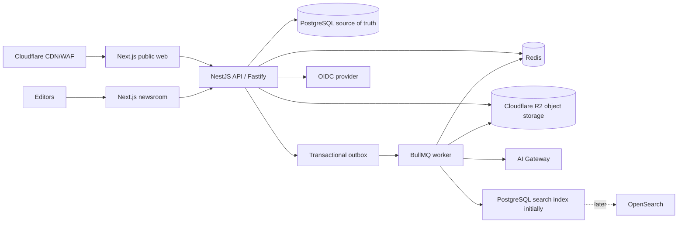
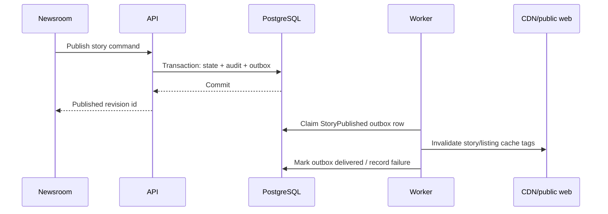

# 03 — Target architecture

A rendered, two-figure version of this architecture (system topology + the publish path, and the worker's job domains/integrations) is kept at [architecture-diagram.html](./architecture-diagram.html) — open it directly in a browser.

## Recommendation

Use a TypeScript monorepo with two Next.js applications, one NestJS/Fastify API, and one worker process. Keep domain modules in a modular monolith and use PostgreSQL as the authoritative store. Redis/BullMQ handles work that should not block HTTP requests. The public web reads a publication-oriented API, not the newsroom database directly.

## Component responsibilities

| Component | Responsibility | Boundary |
|---|---|---|
| Public web | Render approved stories, listing pages, metadata, sitemap, redirects and cache tags | No editorial writes; safe public API only |
| Newsroom | Editor, source inbox, assignments, review, media and analytics screens | OIDC session; writes through API |
| API | Domain commands/queries, authz, REST contracts, transactions, outbox records | Stateless; no direct UI-specific database coupling |
| Worker | Ingestion, media variants, search indexing, AI proposals, notifications, newsletter dispatch, distribution | Idempotent jobs with retry/backoff |
| PostgreSQL | Stories, revisions, translations, taxonomy, sources, media metadata, workflow, audit, outbox | Source of truth |
| Redis | Queue state, short-lived cache, rate-limit counters, locks where needed | Rebuildable/ephemeral |
| Object storage (Cloudflare R2) | Originals and derived media | Immutable-ish objects plus DB metadata |

## Sync versus async

Synchronous request: validate command, authorize, write domain state and outbox event in one PostgreSQL transaction, return a durable identifier.

Asynchronous job: consume outbox event, perform external/API/media/search work, record attempts and result, emit a follow-up event. Public cache invalidation should happen after a committed publication event, not before.

## Why modular monolith first

Editorial transactions are tightly coupled: a publish command touches revision state, translation readiness, audit, schedule, URL, search/indexing intent and cache invalidation. A modular monolith keeps these invariants transactional and deployable as one unit while giving each domain explicit ownership. Split a module only when independent scaling, security isolation, release cadence or failure containment is demonstrated.

## Story performance tracking

FactLens tracks per-story reads with first-party telemetry rather than a third-party analytics API, so "most read"/"trending" rankings are low-latency and don't depend on GA4's reporting delay or query quotas (GA4/GSC remain the source for broader web analytics and SEO reporting; see [technology decisions](./04-technology-decisions.md)).

1. The public web sends a lightweight view beacon once per story render (story id, locale, an anonymized session identifier, referrer) — no PII, no cross-site tracking.
2. A public, rate-limited API endpoint accepts the beacon and increments Redis counters keyed by story id and rolling time windows (e.g. 1h/24h/7d), de-duplicated per session per story per window to resist inflation. These counters drive real-time "most read"/"trending" ranking directly.
3. The `analytics.rollup` worker job periodically flushes Redis counters into a durable `StoryPerformanceDaily` table in PostgreSQL (see [domain model](./05-domain-model.md)), which is the source for historical "most read this week/month" and newsroom reporting.
4. Redis counters are rebuildable/ephemeral, matching Redis's existing role in this architecture; PostgreSQL rollups are the durable record.

## Availability and scaling posture

Run multiple stateless API replicas behind a managed load balancer when traffic justifies it. Use PostgreSQL connection pooling, indexes on publication state/locale/slug/time, CDN caching for public reads, Redis for short-lived coordination, and independently scalable workers. Add read replicas only after measured read pressure. Queue backpressure and idempotency are more valuable than adding infrastructure early.
