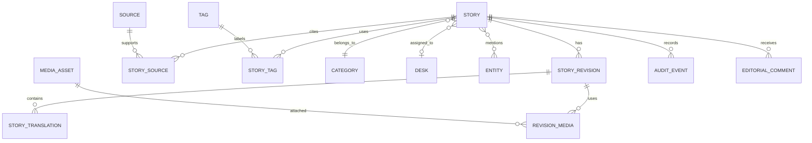

# 05 — Domain model

## Principles

The domain separates a durable **Story** identity from immutable-ish editorial **StoryRevision** records and locale-specific **StoryTranslation** content. A published page points to an approved revision/translation. Strapi’s Article record maps to an initial imported Story plus revision, not to the entire future model.

## Phase 1 entities

- **Story:** stable public identity, lifecycle status, canonical key, current published revision pointer, slug history and timestamps.
- **StoryRevision:** authoring snapshot, changedBy/changedAt, change reason, submitted/approved metadata, correction/AI flags, content hash.
- **StoryTranslation:** locale, title, dek/excerpt, structured body, slug, SEO fields, translation status and source revision link.
- **Contributor:** person/org credited for reporting/editing; imported Author maps here. Keep contact email private.
- **Desk:** editorial ownership and assignment boundary; seed from product decisions, not inferred blindly from categories.
- **Category, Topic, Tag:** controlled taxonomy with slugs, locale labels, aliases and status. Category is navigational; Topic/Tag are discovery labels.
- **Source, StorySource:** structured source identity, URL/canonical URL, publisher/type, published/retrieved times, archive URL, notes, primary/secondary and use type.
- **MediaAsset:** object-storage key, dimensions, MIME, hash, variants, rights/license, source attribution and processing state.
- **SEO metadata:** per translation plus canonical/redirect records; do not bury all SEO in arbitrary JSON.
- **EditorialAssignment, EditorialComment, Correction, AuditEvent:** workflow and traceability primitives.
- **PublishingSchedule:** desired time zone/time, target locale/channel, idempotency key and status.
- **Advertiser, AdCampaign, AdPlacement, Ad, AdEvent:** commercial/distribution capability carried forward from CipherPress's current design — campaign dates/status, weighted/device/locale/category targeting, HMAC-signed redirect tokens and IP-hashed event records. Kept as a separate module from the editorial Story graph; ads are not Story relations and do not appear in editorial workflow states.
- **Configuration, FeatureFlag:** admin-editable runtime policy records (workflow-transition requirements, AI provider/model/budget per use case, rate limits, retention rules, supported locales) and module-level feature toggles. See [configuration and feature flags](./21-configuration-and-feature-flags.md) for what belongs here versus in code.
- **StoryPerformanceDaily:** first-party story-level view rollup (story, locale, date, view count, unique-session estimate) powering "most read"/"trending" rankings; real-time counters live in Redis and flush here (see [target architecture](./03-target-architecture.md)).
- **CardTemplate, GeneratedCard:** branded photocard/poster templates (logo/frame/gradient, text-overlay slots, aspect ratio) and the composited outputs produced from a `MediaAsset` plus story text. `GeneratedCard` is a `MediaAsset` variant linked to its source photo, template id/version and originating story revision (see [media architecture](./10-media-architecture.md)).

## Later entities

Claims/Evidence, rich Entity resolution, Distribution jobs/connectors, AIRun/AIProposal, PromptTemplate (versioned saved prompts referenced by AI use cases; see [AI architecture](./11-ai-architecture.md)), campaign/distribution analytics facts and source snapshots belong after the basic editorial loop works. Add them as bounded modules, not as mandatory fields on every story.

Entity types can include PERSON, ORGANIZATION, COMPANY, GOVERNMENT_AGENCY, POLITICAL_PARTY, COUNTRY, LOCATION, EVENT and INSTITUTION. Start with a simple typed entity table and aliases; defer graph algorithms and automatic resolution.

## Invariants

- A public URL resolves only to an approved/published translation and revision.
- A revision is append-only to editors; corrections create a new revision and Correction record.
- Locale codes are canonical (`en`, `bn-BD`) while UI aliases may be `bn`.
- Slugs are unique within locale and publication surface; old slugs become redirect records.
- Every external source is untrusted input and has provenance, retrieval time and validation status.
- Media object keys are not used as editorial truth; DB metadata controls rights and attachment.
