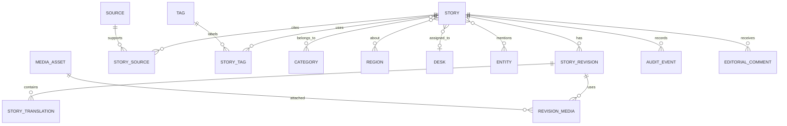

# 05 — Domain model

## Principles

The domain separates a durable **News item** identity from immutable-ish editorial **NewsRevision** records and locale-specific **NewsTranslation** content. A published page points to an approved revision/translation. Strapi’s Article record maps to an initial imported News item plus revision, not to the entire future model.

## Committed entities (Phase 1–4, i.e. by public launch)

- **News item:** stable public identity, lifecycle status, canonical key, current published revision pointer, slug history and timestamps.
- **NewsRevision:** authoring snapshot, changedBy/changedAt, change reason, submitted/approved metadata, correction/AI flags, content hash.
- **NewsTranslation:** locale, title, dek/excerpt, structured body, slug, SEO fields, translation status and source revision link.
- **Contributor:** person/org credited for reporting/editing; imported Author maps here. Keep contact email private. It has a public profile: a bio, one photo from the media library (shown only while the image is ready, allowed on the web, not expired and credited or licensed) and social links per network (the same networks and https-on-its-own-domain rule as the site's social links). The byline on a published news item carries the photo and links; the email never leaves the newsroom.
- **Desk:** editorial ownership and assignment boundary; seed from product decisions, not inferred blindly from categories.
- **Category, Topic, Tag:** controlled taxonomy with slugs, locale labels, aliases and status. Category is navigational; Topic/Tag are discovery labels.
  - **Multilingual by data.** A category or tag is one record with one label row per language (`category_label`, `tag_label`: name, address, aliases, and a description for categories). Which languages exist is the `locale` table, not code, so adding a language (for example `hi`) needs no release: it is added under Configuration, then categories and tags can be named in it and news items translated into it.
  - **Tag page content.** A tag has a short description per language (like a category) and one picture, chosen from the media library, that does not depend on language. The picture is shown publicly only while it is ready, allowed on the web, not expired and has a credit or licence; an image used as a tag picture cannot be deleted.
  - **Naming:** editors and readers see "section"; the code, API and database keep `category` (the cipher-press term), so renaming those is a separate, larger change.
  - **Category** is the news menu: a news item can be in several (at most 10, `news_category`), and one of them is its primary section (`news.category_id`, always one of the set), which the reader's page names first; `position` orders the menu and `show_in_menu` hides a category from it without deleting it. The menu is flat for now (`parent_id` is unused). **Tag**: a news item has many (at most 30). Addresses are unique per language, so `/bn-BD/…/india` and `/en/…/india` do not collide.
  - **Missing translations.** A category or tag with no label in a language is left out of that language's menu, news item and lists; languages are never mixed on a page. The newsroom shows what is missing (open question 21).
  - **Delete.** Something used by news items is archived, not deleted. Changing a name keeps its address so live links keep working.
- **Source, NewsSource:** structured source identity, URL/canonical URL, publisher/type, published/retrieved times, archive URL, notes, primary/secondary and use type.
- **MediaAsset:** object-storage key, dimensions, MIME, hash, variants, rights/license, source attribution and processing state.
- **SEO metadata:** per translation plus canonical/redirect records; do not bury all SEO in arbitrary JSON.
- **EditorialAssignment, EditorialComment, Correction, AuditEvent:** workflow and traceability primitives.
- **PublishingSchedule:** desired time zone/time, target locale/channel, idempotency key and status.
- **Advertiser, AdCampaign, AdPlacement, Ad, AdEvent:** commercial/distribution capability carried forward from CipherPress's current design — campaign dates/status, weighted/device/locale/category targeting, HMAC-signed redirect tokens and IP-hashed event records. Kept as a separate module from the editorial News item graph; ads are not News item relations and do not appear in editorial workflow states.
- **Configuration, FeatureFlag:** admin-editable runtime policy records (workflow-transition requirements, AI provider/model/budget per use case, rate limits, retention rules, supported locales) and module-level feature toggles. See [configuration and feature flags](./21-configuration-and-feature-flags.md) for what belongs here versus in code.
- **NewsletterSubscriber:** email, locale preference, double opt-in/confirmed status, subscribe/unsubscribe timestamps, unsubscribe token, source. Reader-facing but not an account — no login, no other public identity.
- **NewsPerformanceDaily:** first-party per-item view rollup (news item, locale, date, view count, unique-session estimate) powering "most read"/"trending" rankings; real-time counters live in Redis and flush here (see [target architecture](./03-target-architecture.md)).
- **CardTemplate, GeneratedCard:** branded photocard/poster templates (logo/frame/gradient, text-overlay slots, aspect ratio) and the composited outputs produced from a `MediaAsset` plus news item text. `GeneratedCard` is a `MediaAsset` variant linked to its source photo, template id/version and originating news item revision (see [media architecture](./10-media-architecture.md)).

## Later entities

Claims/Evidence, rich Entity resolution, Distribution jobs/connectors, AIRun/AIProposal, PromptTemplate (versioned saved prompts referenced by AI use cases; see [AI architecture](./11-ai-architecture.md)), campaign/distribution analytics facts and source snapshots belong after the basic editorial loop works. Add them as bounded modules, not as mandatory fields on every news item.

Entity types can include PERSON, ORGANIZATION, COMPANY, GOVERNMENT_AGENCY, POLITICAL_PARTY, COUNTRY, LOCATION, EVENT and INSTITUTION. Start with a simple typed entity table and aliases; defer graph algorithms and automatic resolution.

## Invariants

- A public URL resolves only to an approved/published translation and revision.
- A revision is append-only to editors; corrections create a new revision and Correction record.
- Locale codes are canonical (`en`, `bn-BD`) while UI aliases may be `bn`.
- Slugs are unique within locale and publication surface; old slugs become redirect records.
- **Region:** a place a news item is about (Americas, Middle East, South Asia, China ...). It is its own list (`region`, `region_label`), not a menu section: categories make up the news menu, regions do not appear in it. A news item can be about several regions (`news_region`, at most 20; like tags, they belong to the item, not to a revision). Like categories and tags, a region is one record with a name, an address and a description per language, an order (`position`) and a status (active, hidden, archived); a region with no name in a language is left out of that language. Editors manage the list with `taxonomy.manage` and set a news item's regions with `news.edit`. Readers get the list at `GET /public/regions/:locale`, the regions on each news page, and a list of the news about one region with `?region=<address>`. A region in use is archived, not deleted.
- **Format:** every news item is one of `news`, `analysis` or `opinion` (`news.format`, default `news`; set when it is created or in its details). It is part of the content, not of the address and not a category. The public lists can filter on it (`?format=` and `?excludeFormat=`); the site keeps opinion out of its news lists and shows analysis on its own hub. There is no explainer or op-ed format.
- **Public address:** `/story/<slug>-<id>` for every news item. `<id>` is the item's `short_id`: its creation time in milliseconds since 1970 in base 36 (8 characters of 0-9a-z until 2059, for example `mh3k9x2a`), made by the database, unique (a clash takes the next free millisecond, and the API retries a race), the same in every language, never changed. It sorts by creation time and `parseInt(id, 36)` gives the time back; it is not secret, so it reveals when an item was created. The site finds the item by the id; the slug is for people. A wrong or old slug with a known id redirects to the current address; a bare slug (an old link) still resolves. The id is 6 to 8 characters in the contract.
- Every external source is untrusted input and has provenance, retrieval time and validation status.
- Media object keys are not used as editorial truth; DB metadata controls rights and attachment.

## Status

Built as tables: everything in "Committed entities" except Topic, NewsletterSubscriber and NewsPerformanceDaily. Differences and additions:

- **Slugs and redirects** are in `news_slug`, one row per locale and slug, with one current slug per news item and locale. SEO fields are columns on the translation, not a separate table. There is no canonical-URL or legacy-redirect registry yet.
- **Added tables:** `locale` (a row per supported locale, not an enum), `app_role` and `app_role_capability`, `news_contributor`, `revision_media`, `correction_notice` (notice text per locale), `ad_category_target`, `processed_job` (consumer idempotency). The outbox has lease and dead-letter columns.
- **Revisions** are editable until submitted, then locked; "append-only to editors" is enforced in the API, not by a database trigger ([06](./06-editorial-workflow.md)). The audit table is append-only in the database.
- **Media** has rights fields (owner, credit, licence, source, expiry, permitted channels) and a unique checksum ([10](./10-media-architecture.md)).
- **Ads** have tables and constraints but no endpoints.
- Entities, claims, AI runs, prompt templates and ingestion sources have no tables.

See [implementation status](./22-implementation-status.md).
