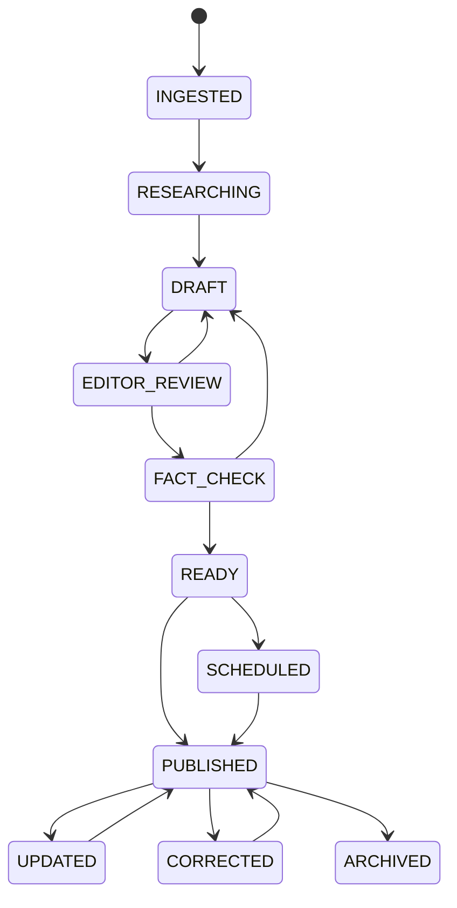

# 06 — Editorial workflow

## Proposed states

Use a story-level workflow with revision-level approval. `INGESTED` is for machine/source intake; human-owned states begin at `RESEARCHING`.

`INGESTED` and `RESEARCHING` are optional for manually originated work. Do not force every story through fact-check if editorial policy says the desk can approve directly; the transition permission should express the policy.

## Transition rules

| Transition | Required evidence/permission |
|---|---|
| Draft → Editor review | Editable revision, required title/body/author/desk, source disclosure policy satisfied |
| Editor review → Fact check | Editor capability; open comments may be allowed but must be visible |
| Fact check → Ready | Fact-check capability, required source/claim checks complete or explicitly waived with reason |
| Ready → Published/Scheduled | Publish capability, locale readiness, SEO validation, media rights check |
| Published → Updated | New revision; old published revision remains addressable in audit/history |
| Published → Corrected | Correction reason, editor approval, visible correction metadata and new revision |
| Any → Archived | Archive capability and reason; preserve URL behavior according to SEO policy |

## Roles and capabilities

Prefer capabilities (`story.edit`, `story.submit`, `story.review`, `story.fact_check`, `story.publish`, `story.correct`, `media.manage`, `taxonomy.manage`, `audit.read`) over hard-coded role checks. Roles are collections of capabilities: Reporter, Desk Editor, Copy Editor, Fact Checker, Managing Editor, Media Editor, Admin, Analyst.

## Audit requirements

Record actor, action, object type/id, previous and new state, revision id, reason, request/trace id, timestamp and source (human/system/AI). Do not rely solely on row `updatedAt`. Audit rows should be append-only to normal application paths and retained per policy.

## AI rules

AI can propose text, extract claims, classify, translate or suggest metadata. It cannot silently overwrite approved content or transition to Published. Store provider/model, prompt/template version, input references, output hash, token/cost/latency and reviewer decision. External source text must be treated as untrusted prompt content.
