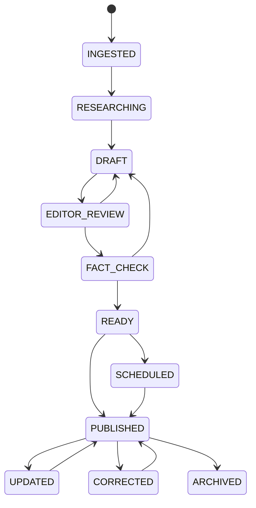

# 06 — Editorial workflow

## Proposed states

Use a story-level workflow with revision-level approval. `INGESTED` is for machine/source intake; human-owned states begin at `RESEARCHING`.

`INGESTED` and `RESEARCHING` are optional for manually originated work. Do not force every story through fact-check if editorial policy says the desk can approve directly; the transition permission should express the policy. Transition requirements are desk-scoped runtime configuration, not a hardcoded global rule — see [configuration and feature flags](./21-configuration-and-feature-flags.md). The state machine's shape (the states themselves) is not configurable this way; changing it is a product decision.

## Transition rules

| Transition | Required evidence/permission |
|---|---|
| Draft → Editor review | Editable revision, required title/body/author/desk, source disclosure policy satisfied |
| Editor review → Fact check | Editor capability; open comments may be allowed but must be visible |
| Fact check → Ready | Fact-check capability, required source/claim checks complete or explicitly waived with reason |
| Ready → Published/Scheduled | Publish capability, locale readiness, SEO validation, media rights check |
| Published → Updated | New revision; old published revision remains addressable in audit/history |
| Published → Corrected | Correction reason, editor approval, visible correction metadata and new revision |
| Any → Archived | Archive capability and reason; preserve URL behavior according to SEO policy |

## Roles and capabilities

Prefer capabilities (`story.edit`, `story.submit`, `story.review`, `story.fact_check`, `story.publish`, `story.correct`, `media.manage`, `taxonomy.manage`, `audit.read`, `ads.manage`, `config.manage`) over hard-coded role checks. Roles are collections of capabilities: Reporter, Desk Editor, Copy Editor, Fact Checker, Managing Editor, Media Editor, Admin, Analyst. `ads.manage` is a commercial capability, independent of editorial roles; Admin holds it by default until an Ad Operations role is defined. `config.manage` gates the runtime configuration/feature-flag surface (see [configuration and feature flags](./21-configuration-and-feature-flags.md)) and should stay narrowly held — it can change rate limits, AI budgets and retention rules without a deploy.

## Audit requirements

Record actor, action, object type/id, previous and new state, revision id, reason, request/trace id, timestamp and source (human/system/AI). Do not rely solely on row `updatedAt`. Audit rows should be append-only to normal application paths and retained per policy.

## AI rules

AI can propose text (including a full rewrite of ingested source content), extract claims, classify, translate or suggest metadata. It cannot silently overwrite approved content or transition to Published. Store provider/model, prompt/template version, input references, output hash, token/cost/latency and reviewer decision. External source text must be treated as untrusted prompt content.

## Implementation notes (apps/api)

How the first implementation reads this document. Change these deliberately; each is a product-visible rule.

- **A revision is editable until it is submitted.** Moving Draft to Editor review locks the working revision (and stores a content hash). Sending a story back opens a new revision that copies the reviewed one, so reviewed text is never edited in place. A published story is revised by creating a new revision (status Updated); the published revision stays live until the new one is published.
- **Capability per move** comes from `workflow.transition_policy` (global, overridable per desk with scope `desk:<id>`). Moves back to Draft and the first steps (Ingested to Researching to Draft) use fixed capabilities. Editor review to Ready is allowed only when the desk does not require a fact check.
- **Readiness rules** (`apps/api/src/stories/validation.ts`): review needs a title and body per translation, an author and a desk; publish adds no machine-draft translations and a license or attribution on every media asset that is processed.
- **Slugs are reserved at publish**, not at draft time. Publishing a slug owned by another story fails with `slug_conflict`. A replaced slug stays in the registry and redirects to the current one.
- **Corrections** require `story.correct`, create a flagged revision plus a correction record with a per-locale notice, and the notice appears on the public page only when the corrected revision is published.
- **Updates and corrections skip review:** the publisher's capability is the approval.
- **Comments** are internal and newsroom-only. They are not edited or deleted; the author or a `story.review` holder resolves or reopens a top-level comment, and replies are one level deep. The story detail carries the open-comment count so it is visible at every hand-off.
- **Assignments** are created by `story.review` holders, one open assignment per person and role. The assignee may complete their own; cancelling takes `story.review`. `GET /assignments/mine` is the desk queue.
- **Sources** are created from the newsroom and deduplicated by canonical URL (tracking parameters and fragments removed). A source stays `unvalidated` until a `story.review` or `story.fact_check` holder accepts or rejects it with a reason; a rejected source cannot be attached. Nothing fetches the URL. Attach notes stay internal.
- **Timeline** (`/stories/:id/timeline`) lists audit events and revision openings, newest first, without request ids or metadata.
- **Scheduled publishing:** Ready to Scheduled records a `publishing_schedule` row (the time is stored with its time zone, in the future, one key per schedule). The worker finds due rows and calls the API, which publishes as `system:scheduler` after re-checking every readiness rule. If publishing is no longer possible (for example the slug was taken meanwhile), the story goes back to Ready, the schedule is marked failed and a `story.schedule_failed` event is queued. Moving a scheduled story back to Ready, or archiving it, cancels the schedule. See [08](./08-ingestion-and-automation.md).
- **Images:** every image in a body needs alt text before review; publishing needs rights that are current and cover the web ([10](./10-media-architecture.md)).
- **Not built yet:** HTML import fixture, search projection, comment mentions and notifications, a calendar of schedules.

