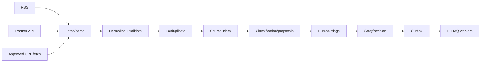

# 08 — Ingestion and automation

## Pipeline

## Boundaries and controls

- Each connector has a source-specific adapter, rate limit, cursor/checkpoint and idempotency key.
- Fetch only approved schemes/hosts, apply DNS rebinding/SSRF protections, timeouts, response-size limits and content-type checks.
- Normalize title, publisher, canonical URL, published time, retrieved time, language and extracted text. Keep raw payload snapshots only under retention/rights policy.
- Deduplicate first by canonical URL/source GUID, then by normalized title/time and content similarity. Never auto-merge ambiguous stories without review.
- AI classification, summarization, translation and entity proposals are separate jobs with provenance; a failed proposal cannot block manual editing.

## Transactional outbox

Domain mutations write the state change, audit event and outbox row in one PostgreSQL transaction. A dispatcher claims rows with leases, publishes BullMQ jobs, retries transient errors, and records terminal failure. Consumers are idempotent using event ID plus operation key. Do not synchronously write PostgreSQL and OpenSearch in one HTTP request.

## Job classes

`source.fetch`, `source.normalize`, `source.dedupe`, `ai.propose`, `media.variant`, `search.index`, `cache.invalidate`, `distribution.prepare`, `analytics.rollup`, and `notification.send`. Keep worker code in module boundaries and make payloads versioned contracts.

## Retry and backpressure

Use exponential backoff with jitter, dead-letter/failed-job inspection, maximum attempts by error class, concurrency limits per connector/provider, and queue age/lag alerts. Use idempotency keys for scheduled publishing, media conversion and social posts. Redis is not the durable event history; PostgreSQL outbox/audit is.
