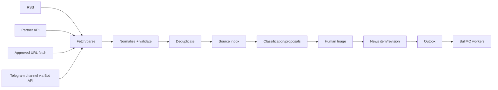

# 08 — Ingestion and automation

## Pipeline

## Boundaries and controls

- Each connector has a source-specific adapter, rate limit, cursor/checkpoint and idempotency key.
- Fetch only approved schemes/hosts, apply DNS rebinding/SSRF protections, timeouts, response-size limits and content-type checks.
- Normalize title, publisher, canonical URL, published time, retrieved time, language and extracted text. Keep raw payload snapshots only under retention/rights policy.
- Deduplicate first by canonical URL/source GUID, then by normalized title/time and content similarity. Never auto-merge ambiguous news items without review.
- AI classification, summarization, translation, rewrite and entity proposals are separate jobs with provenance; a failed proposal cannot block manual editing.

## Source types

- **RSS:** standard feed polling per source with ETag/Last-Modified checkpoints.
- **Partner API:** authenticated pull integrations with provider-specific pagination/cursor handling.
- **Approved URL fetch:** single-URL retrieval from an explicit allowlist, not a general crawler.
- **Telegram channel (Bot API):** a bot account joins each approved channel as admin/member and receives channel posts via webhook or polling. Checkpoint by Telegram message ID; treat the bot token as a managed secret, not environment-committed config. Validate Telegram's webhook secret token on inbound calls. Channel access requires the channel owner's cooperation to add the bot — this is not a way to ingest arbitrary public channels without their participation. Message text/media is untrusted input, normalized and deduplicated identically to RSS/API sources before reaching the source inbox.

Each source type is an explicit allowlist entry, not an open-ended discovery mechanism; adding a new source (including a new Telegram channel) is a configuration change reviewed like any other trust boundary — see [configuration and feature flags](./21-configuration-and-feature-flags.md).

## Transactional outbox

Domain mutations write the state change, audit event and outbox row in one PostgreSQL transaction. A dispatcher claims rows with leases, publishes BullMQ jobs, retries transient errors, and records terminal failure. Consumers are idempotent using event ID plus operation key. Do not synchronously write PostgreSQL and OpenSearch in one HTTP request.

## Job classes

`source.fetch`, `source.normalize`, `source.dedupe`, `ai.propose`, `media.variant`, `media.card_generate`, `search.index`, `cache.invalidate`, `distribution.prepare`, `analytics.rollup`, `newsletter.dispatch`, and `notification.send`. Keep worker code in module boundaries and make payloads versioned contracts.

## Retry and backpressure

Use exponential backoff with jitter, dead-letter/failed-job inspection, maximum attempts by error class, concurrency limits per connector/provider, and queue age/lag alerts. Use idempotency keys for scheduled publishing, media conversion and social posts. Redis is not the durable event history; PostgreSQL outbox/audit is.

## Implementation notes (apps/worker)

- **Dispatcher:** polls `outbox_event`, claims due rows with `FOR UPDATE SKIP LOCKED` and a 60-second lease, turns each into jobs, and marks it dispatched. A failed enqueue retries with exponential backoff and jitter; after 8 tries, or at once for an unknown event type or malformed payload, the row is parked (`failed_at`) and counted in `/health` as a dead letter. Every event type the API writes needs a schema (`packages/contracts/src/jobs.ts`) and a route.
- **Jobs:** one BullMQ queue per family (publish, cache, search, notify, media, maintenance). Each job is a versioned envelope with an idempotency key; outbox-derived jobs use `outbox:<id>:<job type>`, and the key is also the BullMQ job id. Handlers that are not idempotent by themselves record the key in `processed_job` in the same transaction as their work. Failed jobs are kept seven days for inspection; errors marked permanent skip retries.
- **Scheduled publishing:** a repeatable maintenance job scans for due `publishing_schedule` rows and queues `news.publish_scheduled`. The worker calls the API's `/internal/schedules/:id/publish` (shared-secret header, off unless `INTERNAL_API_TOKEN` is set); the API re-checks readiness and publishes as `system:scheduler`. If publishing is no longer possible, the news item returns to READY, the schedule is marked failed and a `news.schedule_failed` event is queued.
- **Stubs:** `cache.invalidate`, `search.index` and `notification.send` log and succeed. `media.variant` and `media.card_generate` fail permanently with "not implemented" so nothing reports success for work nobody did.
- **Not built yet:** OpenTelemetry traces, Sentry, Prometheus metrics, a real cache purge, search projection, media and card jobs, ingestion connectors, retention purge of `processed_job` and old outbox rows.

