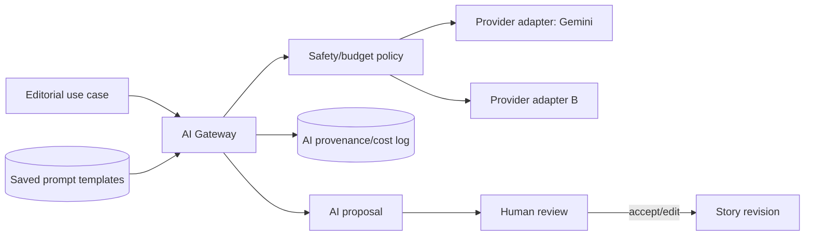

# 11 — AI architecture

## AI Gateway

All model calls go through a central module/service that receives a typed use case, provider policy, model alias, prompt/template version, input references and budget context. It returns a typed proposal plus provenance. Business modules never embed provider SDK calls or API keys.

Gemini (Google) is the initial provider, reached through a dedicated adapter — never called directly from domain modules. The adapter pattern keeps the Gateway able to add or swap providers later without changing use-case call sites.

## Prompt templates

Each use case references a **saved prompt template** by id and version, not a literal string embedded in application code. Templates are stored records (name, use case, version, template body, active/deprecated status) so they can be reviewed and updated without a code deploy, while every AI call still records exactly which template id/version produced a given proposal (see Provenance and cost below). Treat prompt template edits as a reviewed change, not an ad hoc runtime setting — a bad template can degrade every proposal of that use case at once.

## Initial use cases

- headline/dek/SEO suggestions;
- translation proposal between `en` and `bn-BD`;
- source/article summary for research;
- **article rewrite: draft an original-language rewrite of one or more ingested source articles as a starting StoryRevision body, clearly not a verbatim reproduction of the source;**
- claim and named-entity extraction;
- taxonomy suggestions: proposed category, tags/topics and desk, alongside the rewrite draft;
- alt-text and social-card caption copy (text only — the branded card/poster image itself is deterministic template compositing, not AI-generated; see [media architecture](./10-media-architecture.md));
- duplicate-story similarity signal.

These produce drafts/proposals. AI must not publish, overwrite an approved revision, or change workflow state without an explicit authorized human command. A rewrite proposal lands in the story's `DRAFT` state marked AI-proposed (per doc 07's field-provenance UI) and requires a human editor to rewrite/edit it before it can move to review — it is a starting point, not publishable content.

## Provenance and cost

Record use-case, provider, model, prompt/template version, input document IDs/hashes, output hash, token counts, latency, cost estimate, safety result, actor/job and reviewer decision. Retain enough to explain editorial assistance without storing unnecessary sensitive prompt content.

## Safety

External source text is data, not instructions. Delimit and label it to resist prompt injection; strip hidden HTML/script content; avoid sending private contributor data unless policy permits; apply provider data-retention controls; rate-limit and budget per desk/use case; and flag low-confidence or failed safety outputs.

Article rewrite carries a distinct risk from prompt injection: copyright and plagiarism exposure if the output is insufficiently transformed from the source. Always retain and display the source StorySource link and attribution alongside a rewrite draft; do not present rewrite output as ready-to-publish; and apply an editorial transformation-threshold policy (see [open questions](./19-open-questions.md)) before a rewritten story may be approved.
