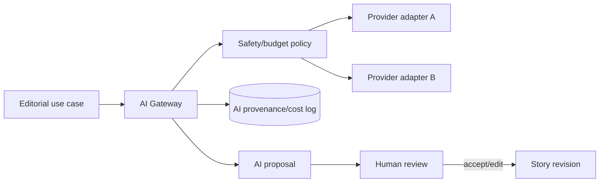

# 11 — AI architecture

## AI Gateway

All model calls go through a central module/service that receives a typed use case, provider policy, model alias, prompt/template version, input references and budget context. It returns a typed proposal plus provenance. Business modules never embed provider SDK calls or API keys.

## Initial use cases

- headline/dek/SEO suggestions;
- translation proposal between `en` and `bn-BD`;
- source/article summary for research;
- claim and named-entity extraction;
- taxonomy suggestions;
- alt-text and social-card copy;
- duplicate-story similarity signal.

These produce drafts/proposals. AI must not publish, overwrite an approved revision, or change workflow state without an explicit authorized human command.

## Provenance and cost

Record use-case, provider, model, prompt/template version, input document IDs/hashes, output hash, token counts, latency, cost estimate, safety result, actor/job and reviewer decision. Retain enough to explain editorial assistance without storing unnecessary sensitive prompt content.

## Safety

External source text is data, not instructions. Delimit and label it to resist prompt injection; strip hidden HTML/script content; avoid sending private contributor data unless policy permits; apply provider data-retention controls; rate-limit and budget per desk/use case; and flag low-confidence or failed safety outputs.
