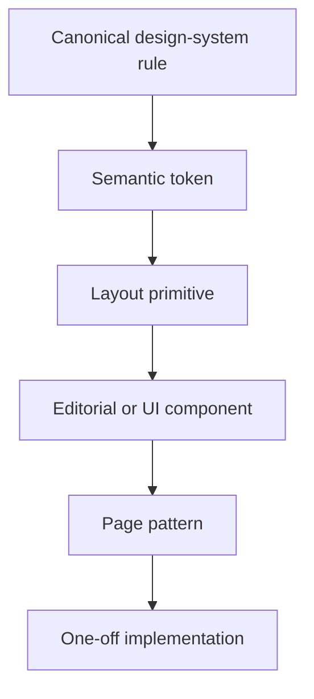
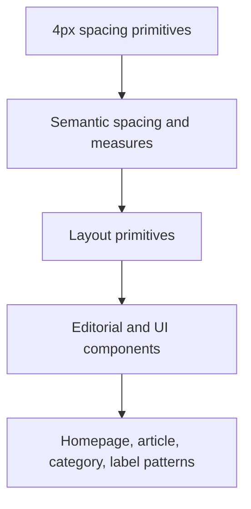
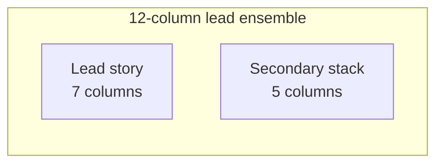
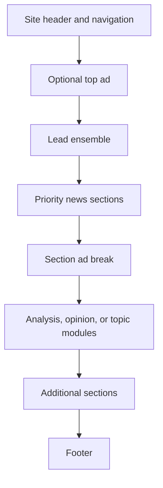
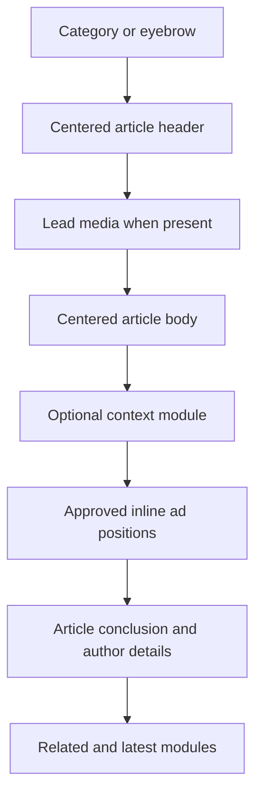
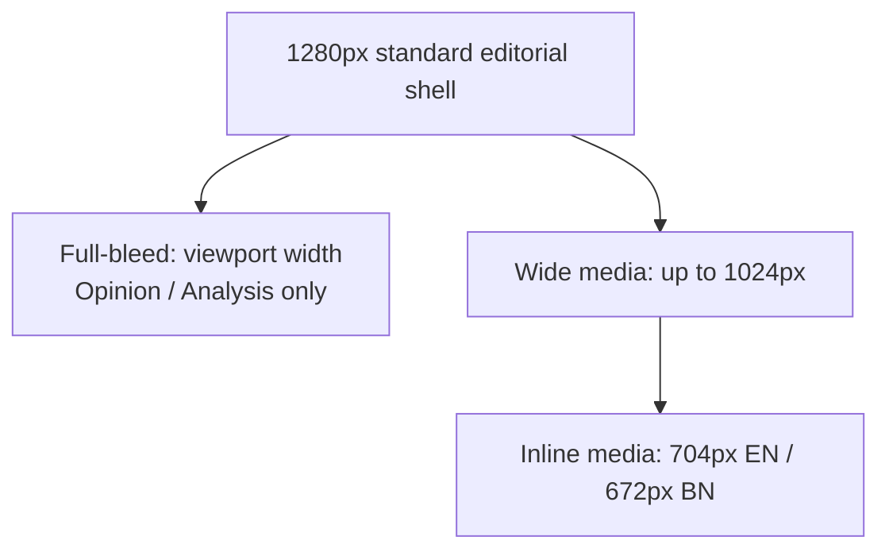
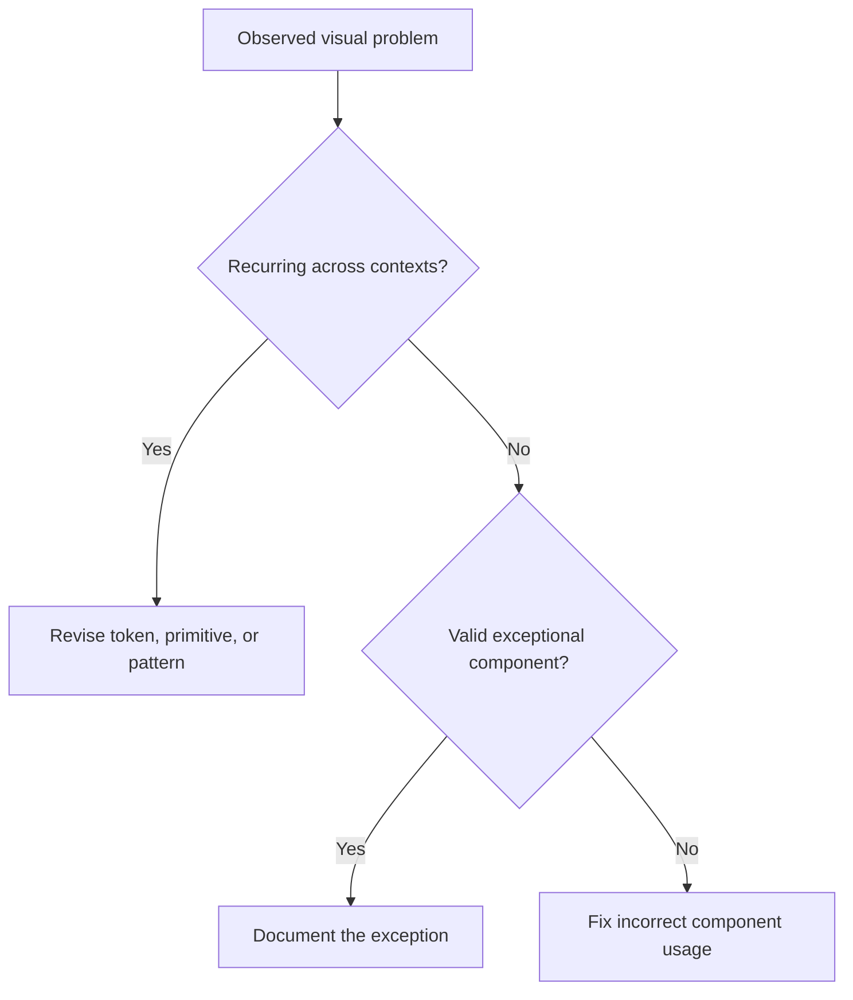
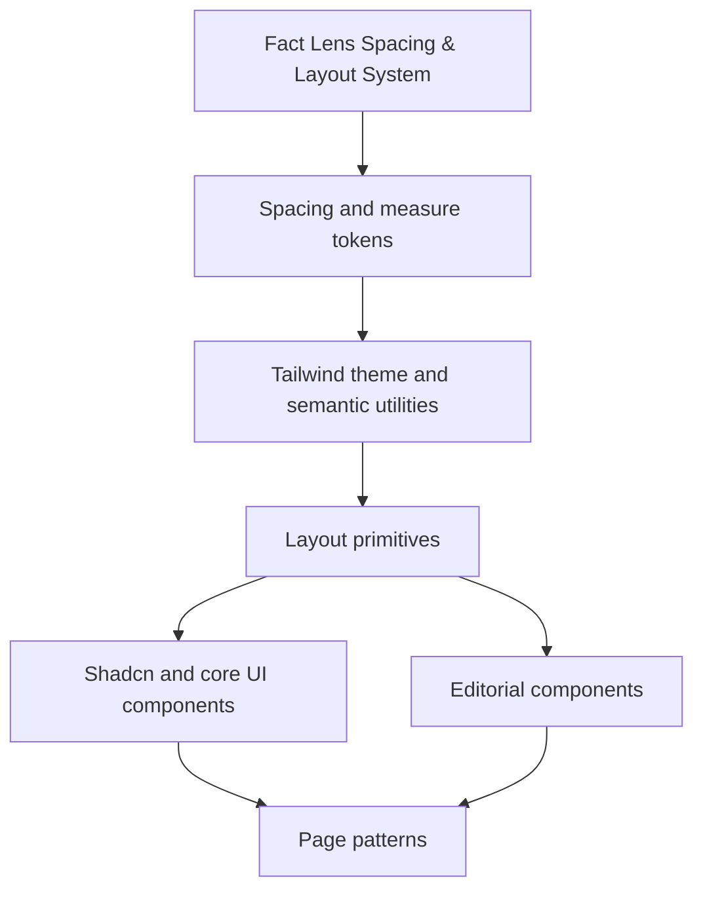

# Fact Lens — Complete Spacing & Layout System v1.1.1

> Canonical spacing and layout reference for design, Figma, Tailwind CSS, Shadcn, Codex, Claude, and human contributors.

## Status

This document defines the implementation-ready **spacing and layout system** for Fact Lens.

It is based on:

- **Fact Lens — Color System**
- **Fact Lens — Typography System**
- The approved international-news layout direction
- The approved peer-group geometry rule

The original v1.0 layout baseline has been calibrated to v1.1 after a real homepage visual test. Revisions remain at the token, primitive, or documented pattern level—not through isolated component overrides.

## v1.1 Changelog

- Reduced the standard editorial shell from `90rem / 1440px` to `80rem / 1280px` so ordinary news pages remain centered and controlled.
- Retained `90rem / 1440px` as the separately requested `measure-shell-wide` for approved environmental and special-feature use.
- Reduced `measure-content` to `72rem / 1152px` and the balanced article context track to `15rem / 240px`.
- Clarified sidecar fit, high-resolution viewports, Figma frames, semantic CSS/component variants, and viewport/zoom validation. The spacing scale, grid, breakpoints, reading measures, media permissions, typography, and color system are unchanged.

## v1.1.1 Corrections

- Clarified article-language propagation, inline context spacing, and nested standard-shell gutters in the implementation examples. No measures, breakpoints, or 2xl spacing values changed.

---

# 1. How to Use This Document

This document serves two audiences.

## Humans

Use the principles, tables, responsive examples, and page-pattern diagrams to understand why the site behaves as it does.

## Codex and Claude

Treat normative words as requirements:

| Word | Meaning |
|---|---|
| **must / must not** | Required or prohibited |
| **should / should not** | Default; deviate only with documented reason |
| **may** | Approved option |

When prose and code examples appear to conflict, apply this authority order:



Higher levels override lower levels.

---

# 2. Layout Character

Fact Lens should feel:

- Centered
- Editorial
- International
- Authoritative
- Information-rich
- Calm rather than sparse
- Structured rather than boxed-in
- Long when more content is needed, not endlessly wide

The overall model is inspired by serious international news publications, while remaining specific to Fact Lens.

The site should **not** resemble:

- A full-width data dashboard
- A generic Shadcn application
- A grid of identical SaaS cards
- A cramped legacy newspaper
- An ultra-minimal magazine with too little information
- A feed that sacrifices hierarchy for uniform density

The central spatial principle is:

> **Use a controlled 1280px editorial shell. When more stories are needed, extend the page vertically rather than widening the composition.**

---

# 3. Foundation Principles

## 3.1 A centered editorial shell

The primary site shell has a maximum content width of:

```text
80rem = 1280px
```

It remains centered and uses responsive page gutters before reaching that maximum. A separate `90rem / 1440px` wide environmental shell is available only when a template explicitly requests an approved wide variant. Viewport canvas and background bands may span `100%`; their ordinary editorial inner content returns to the standard shell. Neither shell has a fixed or minimum width.

## 3.2 Reading width is independent from page width

The standard site shell may be 1280px, but article prose must remain constrained:

| Locale | Canonical prose maximum |
|---|---:|
| English | `44rem` ≈ `704px` |
| Bangla | `42rem` ≈ `672px` |

These values come from the canonical typography system and are referenced here, not redefined.

## 3.3 Hierarchy precedes density

Lead, major, standard, and compact stories receive different grid spans, image sizes, positions, and whitespace. They must not be distinguished through arbitrary font-size overrides.

## 3.4 Open editorial composition is the default

Whitespace, alignment, image scale, and dividers should organize most story groups. `surface` and `surface-alt` are reserved for intentional grouping such as context, newsletter, live coverage, explainers, or related modules.

## 3.5 Layout accommodates canonical typography first

Do not shrink typography to rescue a crowded navigation, card, rail, or headline. Resolve the problem through width, span, gap, wrapping, content limits, ordering, overflow behavior, or responsive reflow first.

## 3.6 Width follows hierarchy; peer geometry follows the group

Component width is determined by the editorial grid and semantic importance—not by headline length.

Within a peer group, outer geometry should remain consistent when it strengthens rhythm. Internal text areas may use different amounts of space.

## 3.7 Accessibility may dissolve symmetry

At large zoom, increased text spacing, or narrow layouts, content must grow or reflow. Equal-height peer behavior remains only while the peer row still exists.

## 3.8 Ads are first-class layout citizens

Ad space must be planned as a distinct semantic region on homepage, article, category, label/topic, and mobile layouts. Ads must never be inserted by stealing ordinary editorial spacing.

---

# 4. Responsibility Boundaries

Text wrapping is a result of typography, layout, component rules, and content. The systems must remain separate.

| Concern | Authority |
|---|---|
| Font family, size, weight, line-height, tracking | Typography system |
| Balanced headline wrapping | Typography system |
| Whether headline clamping is allowed | Typography + component contract |
| Page, grid, card, and text-slot width | Layout system |
| Outer and inner spacing | Layout system |
| Metadata stacking or reordering | Layout + component contract |
| Image crop and aspect ratio | Component/media contract |
| Color, surface, divider, focus color | Color system |
| Actual line count | Typography + width + language + content |

Typography utilities must not contain layout margins or widths. Layout utilities must not redefine font metrics.

Correct:

```tsx
<h1 className="type-article-title text-primary article-title-measure">
  {title}
</h1>
```

Incorrect:

```tsx
<h1 className="text-[42px] leading-[1.1] mt-[27px] max-w-[913px]">
  {title}
</h1>
```

---

# 5. Token Architecture



## 5.1 Primitive tokens

Primitive tokens express raw distance.

## 5.2 Semantic tokens

Semantic tokens describe intent, such as `space-section`, `gutter-page`, or `measure-reading-en`.

## 5.3 Primitives and patterns

`LayoutShell`, `EditorialGrid`, `Stack`, `Cluster`, `ArticleMeasure`, `MediaFrame`, and `AdSlot` consume semantic tokens.

## 5.4 Components

Story items, context modules, navigation, and article elements consume layout primitives instead of inventing geometry.

## 5.5 Page patterns

Pages arrange approved components through documented editorial compositions.

---

# 6. Primitive Spacing Scale

Fact Lens uses a **4px base grid**, with the most common rhythm resolving around multiples of 8px.

| Token | rem | px | Typical use |
|---|---:|---:|---|
| `space-0` | `0` | 0 | Reset |
| `space-1` | `0.25rem` | 4 | Micro separation |
| `space-2` | `0.5rem` | 8 | Icon/text gap, tight stack |
| `space-3` | `0.75rem` | 12 | Compact controls |
| `space-4` | `1rem` | 16 | Base mobile gap |
| `space-5` | `1.25rem` | 20 | Intermediate gap |
| `space-6` | `1.5rem` | 24 | Standard component gap |
| `space-8` | `2rem` | 32 | Component separation |
| `space-10` | `2.5rem` | 40 | Large module spacing |
| `space-12` | `3rem` | 48 | Small section separation |
| `space-16` | `4rem` | 64 | Standard section separation |
| `space-20` | `5rem` | 80 | Desktop section separation |
| `space-24` | `6rem` | 96 | Major editorial separation |
| `space-32` | `8rem` | 128 | Exceptional feature separation |

Rules:

- Use only a listed primitive unless an approved physical constraint requires another value.
- Promote recurring exceptions into the system.
- Do not use fractional arbitrary gaps to visually patch one component.
- Optical adjustments of 1–2px may exist only in documented icons, borders, or media alignment—not general layout.

---

# 7. Semantic Spacing Tokens

Primitive distance alone does not communicate intent. Components should prefer semantic aliases.

## 7.1 Global and section rhythm

| Token | Mobile | Tablet | Desktop | Wide desktop |
|---|---:|---:|---:|---:|
| `gutter-page` | 16px | 24px | 32px | 40px |
| `space-page-start` | 24px | 32px | 40px | 48px |
| `space-section` | 48px | 64px | 80px | 96px |
| `space-section-compact` | 32px | 40px | 48px | 64px |
| `space-module` | 24px | 32px | 40px | 48px |
| `space-section-title-after` | 20px | 24px | 24px | 32px |

## 7.2 Component rhythm

| Token | Default | Purpose |
|---|---:|---|
| `space-component-tight` | 8px | Label to value, icon to label |
| `space-component` | 16px | Common internal relationship |
| `space-component-loose` | 24px | Major internal grouping |
| `space-story-media-text` | 16px | Image to story text |
| `space-story-title-summary` | 8px | Headline to summary |
| `space-story-summary-meta` | 12px | Summary to metadata |
| `space-list-item` | 16px | Compact editorial list items |
| `space-peer-column` | responsive grid gap | Peers in a row |
| `inset-surface-sm` | 16px | Compact surfaced module |
| `inset-surface-md` | 24px | Standard surfaced module |
| `inset-surface-lg` | 32px | Featured surfaced module |

## 7.3 Article flow rhythm

Article flow tokens belong to layout, even when expressed in `em` so they scale with reader controls.

| Token | Value | Meaning |
|---|---:|---|
| `flow-paragraph` | `1.1em` | Paragraph to paragraph |
| `flow-h2-before` | `2.5em` | Strong H2 separation |
| `flow-h2-after` | `0.65em` | H2 to following content |
| `flow-h3-before` | `1.8em` | Moderate H3 separation |
| `flow-h3-after` | `0.55em` | H3 to following content |
| `flow-list-before` | `1em` | Prose to list |
| `flow-list-item` | `0.55em` | List item rhythm |
| `flow-media-before` | `2rem` | Prose to media |
| `flow-media-after` | `2rem` | Media/caption to prose |
| `flow-quote` | `2rem` | Blockquote or pull quote separation |
| `flow-context` | `2rem` | Inline context-module separation |

The article-flow wrapper—not `type-*` typography utilities—owns these margins.

---

# 8. Breakpoints and Behavioral Modes

Use Tailwind-compatible breakpoints as shared infrastructure.

| Token | Minimum width | Typical behavior |
|---|---:|---|
| Base | `0` | 4-column stack; touch-first |
| `sm` | `40rem` / 640px | Larger mobile/small tablet refinements |
| `md` | `48rem` / 768px | 8-column editorial grid |
| `lg` | `64rem` / 1024px | 12-column grid; desktop navigation may appear |
| `xl` | `80rem` / 1280px | Full editorial compositions; context sidecar eligible |
| `2xl` | `96rem` / 1536px | Wide-desktop spacing and grid gap; standard shell stays capped at 1280px |

These are behavior triggers, not device labels. Components should respond to available space rather than assume a specific device.

Do not add a breakpoint for one troublesome headline. If a new breakpoint recurs across patterns, promote it centrally.

---

# 9. Page Gutters and Safe Areas

The shell formula is:

```css
.layout-shell {
  width: min(
    calc(100% - (2 * var(--gutter-page))),
    var(--measure-shell)
  );
  margin-inline: auto;
}
```

Default responsive gutters:

```css
:root { --gutter-page: 1rem; }

@media (min-width: 48rem) {
  :root { --gutter-page: 1.5rem; }
}

@media (min-width: 64rem) {
  :root { --gutter-page: 2rem; }
}

@media (min-width: 96rem) {
  :root { --gutter-page: 2.5rem; }
}
```

At viewports of 1280px and below, the shell remains fluid after subtracting gutters; the 1280px token is a maximum, never a minimum. At wide viewports, background bands can fill the canvas while their ordinary inner content returns to `.layout-shell`. For devices with display cutouts, full-bleed and fixed UI must also respect `env(safe-area-inset-*)`.

---

# 9.1 High-resolution screens and width layers

At QHD, 4K, and ultrawide CSS viewport widths, use these three distinct layers:

| Layer | Width | Contract |
|---|---:|---|
| Viewport canvas | `100%` / `100vw` where technically appropriate | Background, header/section bands, separators, environmental surfaces, ad skins, approved full-bleed media |
| Standard editorial shell | Fluid, maximum `80rem / 1280px` | Default inner layout for all ordinary editorial pages and navigation |
| Optional wide environmental shell | Fluid, maximum `90rem / 1440px` | Explicitly approved ad environments, immersive features, investigations, special data/maps, or utility rails |

Extra viewport width normally becomes balanced outer whitespace. Backgrounds and environmental bands may fill the viewport while content inside normally returns to the standard shell. Do not add columns, widen story cards, or stretch headlines merely because more width is available. Wider screens must preserve hierarchy and reading order. Do not assume OS-level scaling: test 1920px and 2560px **CSS viewport** widths directly.

---

# 10. Canonical Measures

| Token | Value | Role |
|---|---:|---|
| `measure-shell` | `80rem` / 1280px | Canonical standard editorial shell; homepage, category, topic, navigation inner content, article surroundings, related content, ordinary grids |
| `measure-shell-wide` | `90rem` / 1440px | Optional explicitly requested environmental/special-feature shell; never automatic at a breakpoint |
| `measure-content` | `72rem` / 1152px | Calm inner content region when full shell is unnecessary |
| `measure-article-header` | `60rem` / 960px | Category, title, deck, and metadata region |
| `measure-article-title` | `56rem` / 896px | Primary article-title wrap constraint |
| `measure-reading-en` | `44rem` / 704px | English article prose |
| `measure-reading-bn` | `42rem` / 672px | Bangla article prose |
| `measure-media-wide` | `64rem` / 1024px | Expanded article media |
| `measure-context` | `15rem` / 240px | Optional balanced article context sidecar |
| `measure-rail` | `20rem` / 320px | Reserved ad/utility rail; not a permanent article rail |
| `measure-ad-leaderboard` | `60.625rem` / 970px | Maximum conventional leaderboard/billboard region |
| `measure-ad-inline` | `45.5rem` / 728px | Maximum conventional article inline ad region |

Rules:

- `measure-shell` caps ordinary editorial content at 1280px and is fluid below it. `measure-shell-wide` is an explicit variant, never an automatic QHD/4K upgrade.
- Approved wide-shell uses are advertising environments or skins, special investigations, immersive or highly visual features, utility rails outside standard composition, genuinely wide data/map presentations, and deliberately designed wide-feature templates. Ordinary homepage, category, label, navigation, article, and related-content grids retain `measure-shell`.
- Full-viewport backgrounds, separators, ad skins, approved full-bleed media, and immersive surfaces do not widen their ordinary editorial inner content.
- Article headers may be wider than prose.
- English and Bangla prose measures are independent.
- Media and ads may use wider measures without widening prose.
- Rail measures do not authorize permanent sidebars on standard articles.

---

# 11. Editorial Grid

## 11.1 Grid foundation

| Mode | Columns | Column gap |
|---|---:|---:|
| Base | 4 | 16px |
| `md` | 8 | 20px |
| `lg` | 12 | 24px |
| `2xl` | 12 | 32px |

```css
.editorial-grid {
  display: grid;
  grid-template-columns: repeat(4, minmax(0, 1fr));
  column-gap: var(--grid-column-gap);
  row-gap: var(--grid-row-gap, var(--space-module));
}

@media (min-width: 48rem) {
  .editorial-grid { grid-template-columns: repeat(8, minmax(0, 1fr)); }
}

@media (min-width: 64rem) {
  .editorial-grid { grid-template-columns: repeat(12, minmax(0, 1fr)); }
}
```

Always use `minmax(0, 1fr)` to prevent long content from forcing tracks wider.

## 11.2 Standard desktop spans

| Semantic role | Typical span | Notes |
|---|---:|---|
| Lead story | 7–8 of 12 | Largest image and natural headline wrap |
| Major secondary | 4–5 of 12 | Supports lead ensemble |
| Standard story | 4 of 12 | Three-peer row |
| Wide standard story | 6 of 12 | Two-peer row |
| Compact list | 3–4 of 12 | Dense text-led module |
| Section feature | 8 of 12 | Paired with 4-column supporting stack |
| Context sidecar | 2–3 of 12 | Article-only at wide layouts |

Spans are starting patterns, not permission to invent different typography for each grid position.

## 11.3 Nested grids

An editorial module may establish a nested grid inside its assigned span. Nested grids must align with the parent wherever practical and must use semantic gaps.

Do not imitate the 12-column grid through repeated percentage calculations inside components.

---

# 12. Layout Primitives

Fact Lens should implement a small set of local layout primitives. Shadcn does not define the editorial layout system.

| Primitive | Responsibility |
|---|---|
| `LayoutShell` | Centered fluid 1280px maximum and page gutters; explicit `wide` variant only for approved use |
| `ViewportBand` | Full-width environmental/background region, normally containing a standard `LayoutShell` |
| `ContentMeasure` | Optional 1152px inner region |
| `EditorialGrid` | Responsive 4/8/12-column grid |
| `Stack` | Vertical semantic rhythm |
| `Cluster` | Wrapping horizontal relationships |
| `PeerGroup` | Equal outer geometry while items remain in one row |
| `ArticleMeasure` | Locale-aware reading width |
| `ArticleStage` | Centered prose with optional context sidecar |
| `MediaFrame` | Inline, wide, or full-bleed media |
| `AdSlot` | Labeled, reserved, responsive ad region |

Example component API:

```tsx
<LayoutShell>
  <Stack space="section">
    <EditorialGrid>
      {/* editorial modules */}
    </EditorialGrid>
  </Stack>
</LayoutShell>
```

The default `<LayoutShell>` always uses `measure-shell`; only `<LayoutShell variant="wide">` requests `measure-shell-wide` in an approved template. A `ViewportBand` changes the background region, not the inner content measure. Never switch the shell variant at `2xl` or any other viewport breakpoint.

Keep primitive APIs semantic. Avoid props such as `gap={37}` or `maxWidth={1137}`.

---

# 13. Story Prominence Patterns

Homepage hierarchy maps directly from the canonical typography system.

| Story role | Typography role | Layout expression |
|---|---|---|
| Lead | `type-story-lead` | 7–8 columns, dominant image, earliest placement, generous space |
| Major secondary | `type-story-title-lg` | 4–5 columns, strong image or stacked support |
| Standard | `type-story-title` | 4-column three-up or 6-column two-up peer group |
| Compact | `type-story-title-sm` | List or rail pattern; smaller media or text-led |

Prominence must come from the complete combination, not font size alone.

## 13.1 Lead ensemble example



At tablet, the lead remains dominant while supporting stories simplify. At mobile, the ensemble becomes an editorially ordered stack:

1. Lead story
2. Strongest secondary story
3. Remaining secondary stories
4. Ad or section boundary only at an approved insertion point

DOM order should represent this reading order whenever possible.

## 13.2 Standard peer row

A three-up desktop row becomes two-up at a suitable intermediate width and one-up on mobile. Do not preserve tiny three-column cards merely to retain the desktop count.

---

# 14. Peer-Group Geometry and Content Variability

This rule applies to any repeated component group with the same semantic variant—not only cards.

## 14.1 Contract

Peers in the same group should normally share:

- Grid span and width
- Media aspect ratio and displayed dimensions
- Outer padding, when surfaced
- Internal gap tokens
- Typography roles
- Alignment points
- Common row height when the row relationship remains visible

Their text slots may occupy different heights.

| Property | Group-controlled | Content-controlled |
|---|:---:|:---:|
| Outer width | ✓ | — |
| Peer row height | ✓ | — |
| Image ratio | ✓ | — |
| Internal gaps | ✓ | — |
| Headline line count | — | ✓ within limits |
| Summary line count | — | ✓ within limits |
| Residual whitespace | — | ✓ |

## 14.2 English example

| Peer A | Peer B |
|---|---|
| Same image ratio | Same image ratio |
| One-line headline | Two-line headline |
| Two-line summary | Two-line summary |
| More residual space | Less residual space |
| Same outer row height | Same outer row height |

## 14.3 Bangla example

The group contract remains identical, but Bangla uses its own canonical typography metrics. A Bangla peer row may therefore be taller than the corresponding English row.

Do not condense Bangla, reduce its font size, or force numeric height equality with English.

## 14.4 Mixed-language peer group

If English and Bangla appear in one peer group, the tallest legitimate peer determines the row height while the group remains a row.

## 14.5 Implementation pattern

```css
.peer-group {
  display: grid;
  grid-template-columns: repeat(var(--peer-count), minmax(0, 1fr));
  gap: var(--space-peer-column);
  align-items: stretch;
}

.peer-item {
  display: grid;
  grid-template-rows: auto auto 1fr auto;
  height: 100%;
  min-width: 0;
}
```

The tallest peer establishes the grid row. Other peers stretch and absorb remaining space.

Do not use a fragile fixed card height such as `height: 420px`.

## 14.6 Clamping

Follow the canonical typography system:

- Compact story headline: 2–3 lines where product requirements permit
- Standard story headline: generally up to 3 lines
- Lead story headline: natural wrapping
- Article title and body: never clamp

Clamping is a component contract, not a general fix for poor width selection.

## 14.7 Zoom and reflow

At 200% zoom, peers should grow with their content. If they remain in the same grid row, the tallest peer can still equalize the row. If the responsive layout becomes a single column, the peer-row relationship dissolves and each item takes its natural height.

> **Preserve peer geometry while the peer layout exists; accessibility-driven reflow may dissolve that geometry.**

---

# 15. Text Containers and Wrapping

## 15.1 General rule

```text
Typography controls how text behaves.
Layout controls the space text receives.
Content determines the final wrap.
```

## 15.2 Headlines

- Article titles use `measure-article-title` inside `measure-article-header`.
- Lead and story headlines receive the width of their semantic grid span.
- Large headlines may use `text-wrap: balance` as allowed by typography.
- Do not use balance on body copy, metadata, captions, or long UI text.
- Do not shrink a heading solely to force it onto fewer lines.

## 15.3 Paragraphs

- English body uses `measure-reading-en`.
- Bangla body uses `measure-reading-bn`.
- Paragraphs must not use balanced wrapping or clamping.
- Reader font scaling may increase paragraph height without changing the site shell.

## 15.4 Metadata

Metadata uses a wrapping `Cluster`, not a fixed single line.

```css
.metadata-cluster {
  display: flex;
  flex-wrap: wrap;
  align-items: center;
  gap: var(--space-2) var(--space-4);
}
```

On narrow widths, groups may stack. Do not hide important metadata only to preserve a row.

## 15.5 Long unbroken strings

Technical identifiers, URLs, and mixed-script content must not widen the grid.

Use context-appropriate safeguards:

```css
.safe-wrap {
  min-width: 0;
  overflow-wrap: anywhere;
}
```

Do not apply `word-break: break-all` to normal editorial prose.

---

# 16. Homepage System

The homepage uses the standard 1280px editorial shell, but individual sections may choose `measure-content` when a calmer composition is preferable.

## 16.1 Page sequence



The exact editorial sections are product decisions. The spatial contracts are stable.

## 16.2 Section anatomy

Each section should use:

1. Optional top divider or brand rule
2. Section title row
3. `space-section-title-after`
4. One approved story composition
5. Section-end spacing or an explicit ad transition

Avoid wrapping every story in a bordered surface. Use dividers between editorial relationships and surfaces for intentionally grouped modules.

## 16.3 Homepage density

- Above the fold: strongest hierarchy and limited competition.
- Lower page: density may increase through compact patterns.
- More inventory creates additional vertical sections, not extra-wide rows.
- A section should contain a manageable number of visual priorities.
- Repetition of the same three-up grid should be broken by intentional feature, list, topic, or analysis patterns.

## 16.4 Mobile hierarchy

Mobile is not a compressed desktop grid. It is an ordered editorial stack.

- Preserve the lead first.
- Keep major secondary stories visually stronger than compact items.
- Allow summaries to be omitted only through a documented component variant.
- Move lower-priority navigation or story controls rather than shrinking text.
- Use dividers and space to communicate relationships.

---

# 17. Category and Label/Topic Pages

Category and label pages share a structural foundation but may differ editorially.

## 17.1 Header

Use:

- Page title inside `measure-content` or shell-aligned grid
- Optional concise description
- Optional topic navigation or filters using a wrapping `Cluster`
- Clear section-start spacing

## 17.2 Initial feature area

The first story or ensemble may use lead/major roles. Do not make every result visually equal if editorial priority is known.

## 17.3 Result stream

Use a repeatable list or grid with stable image ratios and peer contracts.

Recommended progression:

| Width | Default result behavior |
|---|---|
| Mobile | Single-column ordered stream |
| Tablet | Two-column grid or horizontal story list |
| Desktop | Main results region with optional ad/utility rail |

An ad rail on category or label pages is allowed at desktop because those pages are streams, unlike the centered standard article experience.

## 17.4 Pagination/loading

Pagination, load-more, or infinite-scroll controls must remain visually distinct from ads and editorial results. Do not insert a new result directly against an ad without the required ad separation.

---

# 18. Article Page System

Standard news articles use a centered reading experience with no permanent heavy sidebar.

## 18.1 Article anatomy



This diagram shows logical order; context and ads may appear at approved points within the body.

## 18.2 Header

The header uses:

- `measure-article-header` for the overall region
- `measure-article-title` for the title
- Canonical `type-*` roles
- A wrapping metadata cluster
- `space-page-start` above and semantic article-header gaps within

The title may be centered or left-aligned according to the chosen article template, but the template must be consistent. Standard news should default to left-aligned text inside a centered header region for scanning and mixed-script resilience.

## 18.3 Article body

Resolve the reading measure from the article language:

```css
.article-measure {
  width: 100%;
  max-width: var(--measure-reading-en);
  margin-inline: auto;
}

:lang(bn) .article-measure,
.article-measure:lang(bn) {
  max-width: var(--measure-reading-bn);
}
```

Do not fill the entire article shell with body text.

## 18.4 Context module solution

The context module is a lightweight editorial aid, not a permanent right rail.

Approved content may include:

- Why this matters
- Key facts
- Short timeline
- Actors/entities involved
- Geographic or historical context
- What to watch next

### Wide desktop

At `xl`, if the *actual available shell width* also fits all three tracks and content length is suitable, the context module may become a right sidecar while prose remains geometrically centered in the standard shell. The `xl` breakpoint alone does not guarantee sufficient space after page gutters.

Use a three-track stage:

| Left balance track | Reading measure | Context track |
|---|---|---|
| 240px, balancing track | 672px BN / 704px EN | 240px context track |

Equal 240px outer tracks prevent prose from appearing pushed left merely because context is present. Use the largest applicable canonical two-gap allowance, 32px per gap: English `240 + 32 + 704 + 32 + 240 = 1248px`, leaving 32px within the 1280px shell; Bangla `240 + 32 + 672 + 32 + 240 = 1216px`, leaving 64px. Center the three-track stage itself, including unused space, within the shell. At a 1280px viewport with 32px gutters, 1216px is available: Bangla fits, English does not. Move the English context inline there. Evaluate fit using the rendered shell/container width and current locale, including at zoom; do not squeeze either reading track or borrow width from the optional wide shell.

Implementation example: make the stage a query container and preserve the ordinary inline layout by default. The sidecar belongs in a child grid because a query container cannot query its own width for its own styles. Set the article language on the stage (or an ancestor of the grid); a `lang` attribute on the reading child alone does not affect the grid's language selectors.

```css
.article-stage {
  container: article-stage / inline-size;
  width: 100%; /* Inside the standard .layout-shell */
}

.article-stage__grid {
  display: grid;
  grid-template-columns: minmax(0, 1fr);
  row-gap: var(--flow-context); /* Inline context separation. */
}

.article-stage__reading {
  min-width: 0;
  width: min(100%, var(--measure-reading-en));
  margin-inline: auto;
}

.article-stage__grid:lang(bn) .article-stage__reading {
  width: min(100%, var(--measure-reading-bn));
}

.article-stage__context { /* Inline by default, in editorial DOM order. */
  width: min(100%, var(--measure-context));
  margin-inline: auto;
}

@container article-stage (min-width: 78rem) {
  .article-stage__grid:not(:lang(bn)) {
    grid-template-columns: var(--measure-context) var(--measure-reading-en) var(--measure-context);
    column-gap: var(--space-8);
    justify-content: center;
  }
  .article-stage__grid:not(:lang(bn)) .article-stage__reading { grid-column: 2; }
  .article-stage__grid:not(:lang(bn)) .article-stage__context { grid-column: 3; }
}

@container article-stage (min-width: 76rem) {
  .article-stage__grid:lang(bn) {
    grid-template-columns: var(--measure-context) var(--measure-reading-bn) var(--measure-context);
    column-gap: var(--space-8);
    justify-content: center;
  }
  .article-stage__grid:lang(bn) .article-stage__reading { grid-column: 2; }
  .article-stage__grid:lang(bn) .article-stage__context { grid-column: 3; }
}
```

```tsx
<div className="article-stage" lang={article.lang}>
  <div className="article-stage__grid">
    <div className="article-stage__reading">{/* article section */}</div>
    <aside className="article-stage__context">{/* context */}</aside>
  </div>
</div>
```

The example uses the largest 32px gap as a safe threshold. Reconcile the component's inline context position with the approved article block placement and DOM order; do not visually pull it ahead of its logical reading sequence.

### Below wide desktop

Move context inline whenever the applicable 1216px (Bangla) or 1248px (English) construction does not fit in the available shell, including zoom and narrower viewports:

- After the deck/lead media, or
- After the first logical article section

The editorial meaning determines placement. Never overlay it on prose or reduce the canonical reading width to fit it.

### Visual treatment

Use `surface-alt` or a restrained border/rule, semantic inset spacing, and UI typography for labels. Explanatory prose inside the module may use the appropriate editorial or UI role according to content length.

## 18.5 End-of-article content

Place related stories, latest stories, topic continuation, and newsletter modules after the article rather than in a permanent competing rail.

Use a strong section boundary and normal homepage story variants. The end matter may expand back to `measure-content` or the full shell.

---

# 19. Article Media Widths

Fact Lens supports exactly three semantic article-media levels:

| Variant | Width | Approved use |
|---|---|---|
| `media-inline` | Matches locale reading measure | Ordinary photos, small charts, simple illustrations |
| `media-wide` | Up to `64rem` / 1024px | Maps, satellite imagery, wide photography, detailed charts |
| `media-full-bleed` | Viewport width with safe-area handling | Opinion and Analysis only |

There is no separate `media-container` variant in v1.

## 19.1 Width relationship



## 19.2 Inline media

Centered on and aligned with the article prose. Use for most standard-news imagery.

## 19.3 Wide media

May break outside the reading measure while remaining centered. Use only when extra width improves comprehension or photographic impact.

Do not select `media-wide` merely because a source image is large.

## 19.4 Full-bleed media

Allowed only for Opinion and Analysis templates in v1.

```css
.media-full-bleed {
  width: 100vw;
  margin-inline: calc(50% - 50vw);
}
```

The implementation must prevent accidental horizontal scrolling and account for safe areas and scrollbar behavior.

Standard news articles must not render full-bleed media.

## 19.5 Mobile media

- Inline and wide media both reduce to the available page width.
- A component may intentionally reach the page-gutter boundary.
- Full bleed in approved templates may reach viewport edges.
- Captions retain readable inset padding even when imagery reaches the edge.

## 19.6 Captions and credits

- Inline caption aligns to inline media.
- Wide caption should not become an unreadably long single line; constrain it to the reading measure or a documented caption measure.
- Full-bleed caption aligns to the centered site shell or reading measure, not the viewport edge on large screens.
- Captions use the canonical `type-caption` role.

---

# 20. Images and Aspect Ratios

Aspect ratio belongs to the media/component contract, not the spacing scale.

Recommended v1 families:

| Token | Ratio | Typical use |
|---|---:|---|
| `ratio-landscape` | `16 / 9` | Standard story and article media |
| `ratio-editorial` | `3 / 2` | Feature photography |
| `ratio-wide` | `2 / 1` | Wide banners or panoramic treatment |
| `ratio-square` | `1 / 1` | Compact modules, author/topic imagery |

Rules:

- A peer group uses one shared ratio.
- Do not mix arbitrary image heights in a peer row.
- Use `object-fit: cover` only when editorially safe.
- Maps, charts, documents, and text-bearing graphics should normally use `object-fit: contain` and preserve legibility.
- Meaningful focal points should be stored or controlled rather than cropped accidentally.

---

# 21. Advertising Layout Architecture

Ads are important across the product and must have explicit geometry, labels, and insertion rules.

## 21.1 Semantic ad zones

| Token/variant | Typical context | Maximum content region |
|---|---|---:|
| `ad-top` | Below header/navigation | `measure-ad-leaderboard` |
| `ad-home-section` | Between homepage sections | Leaderboard/billboard region |
| `ad-category-top` | After category header or initial feature | Leaderboard region |
| `ad-stream-inline` | Between result groups | Content or leaderboard region |
| `ad-article-inline` | At approved body boundaries | `measure-ad-inline` or mobile width |
| `ad-rail` | Category/label utility rail | `measure-rail` |
| `ad-mobile-inline` | Between mobile story/article groups | Available width |
| `ad-footer` | Before footer or within footer region | Leaderboard region |

An ad skin or background band may span the viewport. An ad environment may explicitly request `measure-shell-wide` when approved for that placement; its ordinary editorial content and navigation still use `measure-shell`. An ad slot never upgrades the page grid merely because the viewport is wide.

## 21.2 Required anatomy

Every ad slot includes:

1. A visible “Advertisement” / “বিজ্ঞাপন” label
2. Reserved creative region
3. Semantic separation from editorial content
4. A stable responsive format selected before the ad request
5. A collapse policy when no ad is returned

## 21.3 Layout stability

Ad containers must reserve the selected creative size or aspect before content loads to reduce cumulative layout shift.

Do not use one universal fixed height for every viewport. Select a known responsive format, then reserve its corresponding block size.

```tsx
<AdSlot
  placement="article-inline"
  format={{ base: "mobile-banner", lg: "leaderboard" }}
/>
```

## 21.4 Editorial separation

- Ads must not imitate story cards.
- An ad must not appear inside a peer group as if it were another peer story.
- Ads must not interrupt a paragraph, list, quote, figure, or context module.
- Inline article ads go only between complete editorial blocks.
- Keep the ad label visible even when the creative supplies its own branding.
- Ads should not be the first item immediately below an article title.
- Avoid placing ads between title and deck, deck and metadata, or media and its caption.

## 21.5 Homepage placement

Approved locations include:

- Below primary navigation and before the lead ensemble, when commercially required
- Between complete homepage sections
- Inside a purpose-built ad band
- Before the footer

Do not place an ad midway through a peer row.

## 21.6 Article placement

Approved candidates include:

- After lead media and a meaningful opening block
- Between major article sections
- Before end-of-article related content

Exact frequency is an editorial/monetization policy and must not be inferred by the layout component.

## 21.7 Category and label placement

Ads may appear:

- After the page header or initial feature ensemble
- Between complete result groups
- In a desktop ad rail
- Before pagination/load-more

Do not let ad insertion change story numbering, semantic list structure, or keyboard order.

## 21.8 Empty state

If no ad is returned:

- Collapse the creative region according to the ad policy.
- Remove the ad label with it.
- Restore an approved section transition token.
- Do not leave unexplained blank billboard-height space.

---

# 22. Navigation and Congestion

Navigation uses canonical UI typography. The layout must solve congestion before typography changes.

Resolution order:

1. Use approved minimum/maximum navigation gaps.
2. Prioritize core destinations.
3. Move lower-priority destinations into a `More` menu or secondary row.
4. Allow an intentional horizontally scrollable category strip where appropriate.
5. Change navigation structure at the relevant breakpoint.
6. Switch to mobile navigation earlier.
7. Revisit a typography token only if implementation shows a systemic optical problem.

Do not condense Noto Sans Bengali UI simply to fit more destinations.

Navigation controls must use adequate hit areas and visible focus treatment. Dropdowns and mega menus must remain inside viewport-safe bounds.

---

# 23. Surface, Divider, and Whitespace Use

The color system supplies `background`, `surface`, `surface-alt`, borders, and elevated surfaces. Layout determines when they are structurally useful.

## 23.1 Default

Use open composition with:

- Grid alignment
- Whitespace
- Image scale
- Headline hierarchy
- Subtle dividers

## 23.2 Use a surface when

- Several items form a distinct module
- Content has a separate interaction model
- Context or explanatory material must be differentiated
- A newsletter or callout needs containment
- A popover/dialog genuinely requires elevation

## 23.3 Do not use a surface when

- The only goal is to make every story look clickable
- Whitespace and alignment already communicate grouping
- It creates nested cards
- It makes the site resemble a dashboard

Theme changes affect color tokens, not spacing or geometry.

---

# 24. Responsive Reflow Rules

## 24.1 General priority

When space becomes insufficient:

1. Preserve content and semantic order.
2. Reduce column count.
3. Reassign semantic spans.
4. Stack or wrap supporting elements.
5. Move context and rails inline.
6. Reduce gaps only within the approved responsive token range.
7. Omit optional content only through an explicit component variant.
8. Never solve the problem through arbitrary typography reduction.

## 24.2 Pattern transitions

| Pattern | Wide desktop | Tablet | Mobile |
|---|---|---|---|
| Lead ensemble | 7+5 or 8+4 | Dominant lead + support grid | Ordered stack |
| Three standard peers | 3 columns | 2 columns + continuation | 1 column |
| Two wide peers | 2 columns | 2 or 1 columns | 1 column |
| Article context | Balanced sidecar | Inline | Inline |
| Category with rail | Results + rail | Results only | Single stream |
| Wide media | Up to 1024px | Available width | Gutter width |
| Full bleed | Approved templates only | Viewport width | Viewport width |

## 24.3 Container queries

Reusable editorial components embedded in multiple contexts should prefer container queries for internal changes. Page-level compositions still use shared viewport breakpoints.

Do not make a story component infer prominence from viewport width alone; pass or derive an explicit semantic variant.

---

# 25. Accessibility and Resilience

## 25.1 Browser zoom

The site must remain usable at 200% browser zoom.

- Text grows or reflows; it must not clip.
- Effective viewport width may trigger narrower patterns.
- Peer items equalize only if they remain peers in one row.
- Horizontal scrolling must not be required for ordinary page content.

## 25.2 Text spacing

Components must tolerate user-increased letter spacing, word spacing, and line height.

Avoid:

- Fixed block heights around text
- Vertically centered multi-line text in rigid slots
- Hidden overflow on content containers
- Absolute positioning that depends on exact line count
- Single-line metadata assumptions

## 25.3 Touch targets

Interactive controls should normally provide at least a `44px × 44px` target region, even when the visible icon is smaller.

Inline editorial links are exempt from box-shaped target dimensions but must remain distinguishable and operable.

## 25.4 Focus and sticky regions

- Use the canonical visible focus ring.
- Sticky headers must not hide focused content or anchored headings.
- Account for sticky offsets with `scroll-margin-block-start`.
- Do not trap keyboard focus inside navigation or ad regions.

## 25.5 Source order

Visual reordering must not create a confusing keyboard or screen-reader order. Prefer semantic DOM order matching the mobile reading sequence.

## 25.6 Reduced motion

Layout must not depend on motion for comprehension. Any later animated transitions must respect `prefers-reduced-motion`.

---

# 26. CSS Token Reference

```css
:root {
  /* Primitive spacing */
  --space-0: 0;
  --space-1: 0.25rem;
  --space-2: 0.5rem;
  --space-3: 0.75rem;
  --space-4: 1rem;
  --space-5: 1.25rem;
  --space-6: 1.5rem;
  --space-8: 2rem;
  --space-10: 2.5rem;
  --space-12: 3rem;
  --space-16: 4rem;
  --space-20: 5rem;
  --space-24: 6rem;
  --space-32: 8rem;

  /* Measures */
  --measure-shell: 80rem;
  --measure-shell-wide: 90rem;
  --measure-content: 72rem;
  --measure-article-header: 60rem;
  --measure-article-title: 56rem;
  --measure-reading-en: 44rem;
  --measure-reading-bn: 42rem;
  --measure-media-wide: 64rem;
  --measure-context: 15rem;
  --measure-rail: 20rem;
  --measure-ad-leaderboard: 60.625rem;
  --measure-ad-inline: 45.5rem;

  /* Responsive semantic spacing */
  --gutter-page: var(--space-4);
  --space-page-start: var(--space-6);
  --space-section: var(--space-12);
  --space-section-compact: var(--space-8);
  --space-module: var(--space-6);
  --space-section-title-after: var(--space-5);
  --grid-column-gap: var(--space-4);

  /* Component rhythm */
  --space-component-tight: var(--space-2);
  --space-component: var(--space-4);
  --space-component-loose: var(--space-6);
  --space-story-media-text: var(--space-4);
  --space-story-title-summary: var(--space-2);
  --space-story-summary-meta: var(--space-3);
  --space-list-item: var(--space-4);
  --space-peer-column: var(--grid-column-gap);
  --inset-surface-sm: var(--space-4);
  --inset-surface-md: var(--space-6);
  --inset-surface-lg: var(--space-8);

  /* Article flow */
  --flow-paragraph: 1.1em;
  --flow-h2-before: 2.5em;
  --flow-h2-after: 0.65em;
  --flow-h3-before: 1.8em;
  --flow-h3-after: 0.55em;
  --flow-list-before: 1em;
  --flow-list-item: 0.55em;
  --flow-media-before: var(--space-8);
  --flow-media-after: var(--space-8);
  --flow-quote: var(--space-8);
  --flow-context: var(--space-8);
}

@media (min-width: 48rem) {
  :root {
    --gutter-page: var(--space-6);
    --space-page-start: var(--space-8);
    --space-section: var(--space-16);
    --space-section-compact: var(--space-10);
    --space-module: var(--space-8);
    --space-section-title-after: var(--space-6);
    --grid-column-gap: var(--space-5);
  }
}

@media (min-width: 64rem) {
  :root {
    --gutter-page: var(--space-8);
    --space-page-start: var(--space-10);
    --space-section: var(--space-20);
    --space-section-compact: var(--space-12);
    --space-module: var(--space-10);
    --grid-column-gap: var(--space-6);
  }
}

@media (min-width: 96rem) {
  :root {
    --gutter-page: var(--space-10);
    --space-page-start: var(--space-12);
    --space-section: var(--space-24);
    --space-section-compact: var(--space-16);
    --space-module: var(--space-12);
    --space-section-title-after: var(--space-8);
    --grid-column-gap: var(--space-8);
  }
}
```

Spacing and geometry remain the same in light and dark themes.

---

# 27. Tailwind and Shadcn Integration

## 27.1 Tailwind role

Tailwind expresses the system. It does not define the system.

Prefer reusable semantic classes or primitives:

```tsx
<main className="layout-shell">
  <section className="section-stack editorial-grid">
    ...
  </section>
</main>
```

Avoid:

```tsx
<main className="mx-auto max-w-[1377px] px-[19px] lg:px-[35px]">
```

## 27.2 Recommended semantic utilities

```css
.layout-shell,
.layout-shell-wide {
  width: min(
    calc(100% - (2 * var(--gutter-page))),
    var(--measure-shell)
  );
  margin-inline: auto;
}

.layout-shell-wide {
  /* Apply only through an explicitly approved wide variant. */
  width: min(
    calc(100% - (2 * var(--gutter-page))),
    var(--measure-shell-wide)
  );
}

.layout-shell-wide > .layout-shell {
  /* The wide parent already supplies page gutters; do not subtract them again. */
  width: min(100%, var(--measure-shell));
}

.viewport-band {
  width: 100%;
  /* Environmental surface; put ordinary editorial content in .layout-shell. */
}

.content-measure {
  width: min(100%, var(--measure-content));
  margin-inline: auto;
}

.article-header-measure {
  width: min(100%, var(--measure-article-header));
  margin-inline: auto;
}

.article-title-measure {
  max-width: var(--measure-article-title);
}

.article-measure {
  width: min(100%, var(--measure-reading-en));
  margin-inline: auto;
}

:lang(bn) .article-measure,
.article-measure:lang(bn) {
  width: min(100%, var(--measure-reading-bn));
}

.section-stack > * + * {
  margin-block-start: var(--space-section);
}

.media-wide {
  width: min(
    calc(100vw - 2 * var(--gutter-page)),
    var(--measure-media-wide)
  );
  max-width: none;
  position: relative;
  left: 50%;
  transform: translateX(-50%);
}
```

## 27.3 Explicit React shell variant

```tsx
type LayoutShellProps = {
  variant?: "standard" | "wide";
  children: React.ReactNode;
};

export function LayoutShell({ variant = "standard", children }: LayoutShellProps) {
  return (
    <div className={variant === "wide" ? "layout-shell-wide" : "layout-shell"}>
      {children}
    </div>
  );
}

// Normal sections and navigation inner content:
<LayoutShell>{/* editorial content */}</LayoutShell>

// Only inside a specifically approved wide-feature or ad environment:
<LayoutShell variant="wide">{/* approved wide content */}</LayoutShell>

// If ordinary editorial content is nested directly inside a wide environment,
// the inner standard shell retains its 1280px cap without a second gutter deduction:
<LayoutShell variant="wide">
  <LayoutShell>{/* ordinary editorial content */}</LayoutShell>
</LayoutShell>

// A viewport-wide surface still contains standard editorial content:
<section className="viewport-band">
  <LayoutShell>{/* ordinary editorial content */}</LayoutShell>
</section>
```

Do not derive `variant` from viewport size. In Tailwind CSS v4, define these semantic classes in the layout stylesheet and use the CSS measure variables as the source of truth; arbitrary `max-w-*` and responsive wide-shell overrides must not bypass them.

## 27.4 Shadcn role

Shadcn supplies accessible UI primitives, but its default padding, radius, typography, and app-like card patterns are subordinate to Fact Lens.

- Map dialogs, menus, inputs, buttons, and popovers to semantic Fact Lens spacing.
- Do not use Shadcn `Card` as the default editorial story wrapper.
- Editorial components live outside generic `components/ui`.
- A Shadcn component may consume `surface`, `border`, and spacing tokens without defining editorial geometry.

---

# 28. Figma Mapping

Figma should mirror the semantic architecture instead of maintaining unrelated spacing values.

## 28.1 Variable collections

Create these collections:

| Collection | Examples | Modes |
|---|---|---|
| `Spacing / Primitive` | `space/1`, `space/2`, `space/4`, `space/8` | One mode |
| `Spacing / Semantic` | `section`, `module`, `component`, `story/media-text` | Mobile, Tablet, Desktop, Wide |
| `Layout / Measure` | `shell/standard` (1280px), `shell/wide` (1440px, optional), `content` (1152px), `article/header`, `reading/en` (704px), `reading/bn` (672px), `media/wide` | One mode |
| `Layout / Grid` | `columns`, `column-gap`, `page-gutter` | Mobile, Tablet, Desktop, Wide |

Do not duplicate spacing variables for light and dark themes. Geometry is theme-independent.

## 28.2 Layout grids

Create page-frame grid styles matching implementation:

| Figma style | Columns | Gutter | Margin behavior |
|---|---:|---:|---|
| `Grid / Mobile` | 4 | 16px | 16px minimum |
| `Grid / Tablet` | 8 | 20px | 24px minimum |
| `Grid / Desktop` | 12 | 24px | 32px minimum |
| `Grid / Wide` | 12 | 32px | Centered 1280px standard shell; 40px minimum |
| `Grid / Approved Wide Feature` | 12 | 32px | Centered optional 1440px wide shell; only for an explicitly approved template |

Use a viewport canvas matching the example viewport, with viewport-wide surfaces behind a centered 1280px standard editorial-shell frame. Add a distinct 1440px **optional wide-shell** frame only for approved examples; do not label a 1440px frame as the default desktop content shell. Display the centered 1152px content measure and locale-specific 704px English / 672px Bangla article reading frames within the standard shell. A 1440px *viewport* example still uses the 1280px standard inner shell.

## 28.3 Auto Layout rules

- Map Auto Layout gaps and padding to semantic variables.
- Use `Fill container` for peer widths within a grid-derived wrapper.
- Use `Hug contents` for text-driven height.
- Use stretch/equal-height behavior at the peer-group wrapper, not fixed component heights.
- Represent mobile reflow as a component property or distinct documented responsive example.
- Create article-media variants named `inline`, `wide`, and `full-bleed` only.

Figma examples are explanatory specifications. CSS behavior remains authoritative for actual reflow, zoom, text-spacing, and content growth.

---

# 29. React Primitive Examples

## 29.1 Locale-aware article measure

```tsx
type ArticleMeasureProps = {
  lang: "en" | "bn";
  children: React.ReactNode;
};

export function ArticleMeasure({ lang, children }: ArticleMeasureProps) {
  return (
    <div lang={lang} className="article-measure">
      {children}
    </div>
  );
}
```

Language differences resolve through tokens/selectors, not inline ternaries full of raw values.

## 29.2 Semantic media

```tsx
type MediaWidth = "inline" | "wide" | "full-bleed";
type ArticleKind = "news" | "opinion" | "analysis";

function resolveMediaWidth(width: MediaWidth, kind: ArticleKind) {
  if (width === "full-bleed" && kind === "news") return "inline";
  return width;
}
```

The CMS should validate this rule too; the UI guard is not the only enforcement.

## 29.3 Peer group

```tsx
<div className="peer-group" style={{ "--peer-count": 2 } as React.CSSProperties}>
  {stories.map((story) => (
    <StoryItem key={story.id} variant="standard" className="peer-item" />
  ))}
</div>
```

In production, prefer named responsive variants rather than unrestricted numeric props.

---

# 30. Recommended File Architecture

```text
src/
├─ styles/
│  ├─ globals.css
│  ├─ colors.css
│  ├─ typography.css
│  └─ layout.css
│
├─ components/
│  ├─ layout/
│  │  ├─ layout-shell.tsx
│  │  ├─ editorial-grid.tsx
│  │  ├─ stack.tsx
│  │  ├─ cluster.tsx
│  │  ├─ peer-group.tsx
│  │  ├─ article-measure.tsx
│  │  ├─ media-frame.tsx
│  │  └─ ad-slot.tsx
│  │
│  ├─ ui/
│  └─ editorial/
│
└─ app/
   ├─ [lang]/
   └─ ...
```

Responsibilities:

| File/area | Responsibility |
|---|---|
| `layout.css` | Primitive/semantic spacing, measures, grids, flow utilities |
| `components/layout` | Reusable structural primitives |
| `components/ui` | Shadcn/interface components |
| `components/editorial` | Story, article, context, and editorial modules |
| Page routes/templates | Approved page compositions and content order |

---

# 31. Codex and Claude Implementation Rules

## Rule 1 — Never invent layout values

Use canonical spacing, measure, grid, and flow tokens. Raw values require an explicit exceptional-component reason.

## Rule 2 — Preserve the 1280px standard shell

Ordinary homepage, category, label, navigation, article, and related-content compositions use the fluid 1280px maximum. Only explicitly approved templates/components request the 1440px `measure-shell-wide` variant. Full-viewport environmental surfaces normally nest the standard shell. Do not upgrade based on viewport width.

## Rule 3 — Make pages longer, not wider

When content inventory increases, add sections or denser approved patterns below—not more columns beyond the system.

## Rule 4 — Preserve locale reading measures

English prose uses `44rem`; Bangla prose uses `42rem`. Do not use one generic width for both.

## Rule 5 — Typography is not a layout escape hatch

Resolve overflow through layout, content, responsive behavior, and wrapping before proposing a token-level typography change.

## Rule 6 — Width follows semantic hierarchy

Do not make a component wider because its headline is longer.

## Rule 7 — Respect peer-group geometry

Peers of the same semantic variant share outer geometry while the row exists. Internal text allocation may vary.

## Rule 8 — Do not hard-code text-container heights

Use content growth, grid stretching, minimums, and approved clamping. Never clip critical editorial text to preserve symmetry.

## Rule 9 — Reflow at zoom and narrow widths

If a peer row becomes a stack, allow natural item heights. Accessibility overrides forced symmetry.

## Rule 10 — Use only three article-media widths

`inline`, `wide`, and `full-bleed`. Full bleed is limited to Opinion and Analysis.

## Rule 11 — Keep standard articles centered

Do not add a permanent heavy sidebar. The optional context module becomes a balanced sidecar only at wide sizes and moves inline otherwise.

## Rule 12 — Put related/latest content after the article

Do not surround the reading column with competing recommendation rails.

## Rule 13 — Ads use `AdSlot`

Never paste ad markup into arbitrary gaps. Use an approved placement, label, reserved format, and empty-state policy.

## Rule 14 — Ads are not editorial peers

Do not place an ad inside a story peer row or style it as a story.

## Rule 15 — Open composition is the baseline

Do not wrap every story in a Shadcn Card. Use surfaces only for meaningful containment.

## Rule 16 — DOM order follows editorial reading order

Responsive CSS must not produce a misleading keyboard or screen-reader sequence.

## Rule 17 — Dark mode changes color, not geometry

Do not create dark-specific spacing, widths, or breakpoints.

## Rule 18 — Promote recurring exceptions

If a one-off value appears in more than one place, stop and propose a semantic token or documented variant.

---

# 32. Prohibited Patterns

Do not use:

```tsx
className="gap-[22px] max-w-[1170px] px-[19px]"
```

Do not promote the wide shell automatically at a large breakpoint:

```tsx
<LayoutShell variant={is2xl ? "wide" : "standard"} />
```

Do not use viewport-wide article prose:

```css
.article-body { max-width: none; }
```

Do not force peer height with a fragile constant:

```css
.story-card { height: 420px; overflow: hidden; }
```

Do not solve Bangla navigation with condensed typography.

Do not render standard-news media as full bleed.

Do not insert ads between an image and its caption or inside a paragraph.

Do not create separate spacing systems for Bangla, English, light mode, and dark mode. Language-specific reading measures are the documented exception.

---

# 33. Validation Matrix

Every major layout release must be reviewed on at least:

| Page | English | Bangla | Mobile | Desktop | 200% zoom |
|---|:---:|:---:|:---:|:---:|:---:|
| Homepage | ✓ | ✓ | ✓ | ✓ | ✓ |
| Standard article | ✓ | ✓ | ✓ | ✓ | ✓ |
| Analysis/opinion article | ✓ | ✓ | ✓ | ✓ | ✓ |
| Category page | ✓ | ✓ | ✓ | ✓ | ✓ |
| Label/topic page | ✓ | ✓ | ✓ | ✓ | ✓ |

Also test:

- Short and very long headlines
- One-, two-, and three-line peer headlines
- Summaries of unequal length
- Mixed English/Bangla technical identifiers
- Missing images
- Portrait, landscape, map, and chart media
- Reader size `A−`, `A`, and `A+`
- Empty and loaded ad slots
- Increased user text spacing
- Keyboard navigation and focus visibility
- Slow ad/media loading for layout stability

---

# 34. Acceptance Criteria

The v1.1 implementation is acceptable when:

1. The fluid standard shell never exceeds 1280px and stays centered; approved wide variants alone may reach 1440px.
2. English and Bangla article measures resolve correctly.
3. Homepage hierarchy survives all responsive modes.
4. Peer rows maintain outer symmetry without fixed text heights.
5. Peer symmetry dissolves safely when layouts stack.
6. Standard article prose remains centered with or without context.
7. Context moves inline before it can squeeze prose.
8. Only Opinion and Analysis can request full-bleed media.
9. Ads appear only in approved semantic slots and reserve their chosen size.
10. Empty ad slots follow the documented collapse behavior.
11. No critical text clips at 200% zoom.
12. No ordinary content creates horizontal page scrolling.
13. Shadcn defaults do not override editorial spacing or geometry.
14. Components contain no unjustified recurring arbitrary spacing or width values.
15. QHD/4K standard grids, story cards, and headlines do not expand because of viewport width; outer whitespace is intentional and full-width environmental surfaces may frame the standard shell.
16. At 1280px, 1440px, 1920px, and 2560px CSS viewports and 200% zoom, the hierarchy, source/reading order, centered article prose, and fluid behavior remain intact, with no horizontal overflow.
17. Approved ads and special features may use environmental or explicitly wide space without changing ordinary editorial grid geometry.

---

# 35. Initial Visual Calibration Protocol

After the first real Codex/Claude implementation, review these representative screens:

1. English homepage — 1280px and 1440px CSS viewports
2. Bangla homepage — 1280px and 1440px CSS viewports
3. English homepage — mobile
4. Bangla homepage — mobile
5. English standard article — with context and inline ad
6. Bangla standard article — with context and inline ad
7. Analysis article — wide and full-bleed media
8. Category page — desktop rail and mobile stream
9. Peer group — short/long English content
10. Peer group — short/long Bangla content
11. All representative pages — 200% zoom
12. English and Bangla homepages, articles, category and label pages — 1920px and 2560px CSS viewports, checking standard-shell cap and deliberate outer whitespace
13. An explicitly approved wide-shell template and a viewport band — verify wide content requires an explicit variant and ordinary inner content remains standard
14. Article with context — verify English 1248px / Bangla 1216px minimum three-track space, including the 1280px viewport boundary

Review in this order:

1. Reading comfort and centering
2. Editorial hierarchy
3. Peer geometry
4. Section rhythm and homepage density
5. Context-module prominence
6. Media expansion
7. Ad separation and layout stability
8. Navigation congestion
9. Mobile order

If a systemic issue is found, revise the narrowest authoritative layer that owns it:



Do not scatter compensating overrides.

---

# 36. Canonical Summary

```text
Base spacing                 4px
Primary rhythm              Mostly 8px multiples
Standard editorial shell    1280px / 80rem centered maximum
Optional wide shell         1440px / 90rem explicitly requested
Content measure             1152px / 72rem
Article context track       240px / 15rem
Grid                        4 / 8 / 12 columns
Page gutters                16 / 24 / 32 / 40px
English reading measure     704px
Bangla reading measure      672px
Article header measure      960px
Article title measure       896px
Wide article media          Up to 1024px
Article media variants      Inline / Wide / Full bleed
Full-bleed permission       Opinion and Analysis only
Standard article rail       None
Article context             Optional sidecar → inline on narrower layouts
Related/latest content      End of article
Homepage growth             Longer, not wider
Editorial composition       Open by default
Peer groups                 Shared outer geometry while row exists
Accessibility               Content growth/reflow overrides forced symmetry
Ads                         First-class semantic slots on all page families
Theme behavior              Same geometry in light and dark
```

---

# 37. Source-of-Truth Rule

This document is the canonical Fact Lens spacing and layout source.



Tailwind utilities express the system; they do not define it.

Shadcn components consume the system; they do not define it.

Codex and Claude must not infer new spacing, widths, grid rules, media modes, ad placements, or responsive behavior when this document already provides an applicable role. The standard shell is always `measure-shell` (1280px maximum); a viewport band is environmental, and `measure-shell-wide` (1440px maximum) requires an explicit approved semantic variant. Neither Tailwind nor Shadcn should map large breakpoints to the wide variant automatically.

Any future addition must define:

1. Semantic purpose
2. Token or primitive relationship
3. Responsive behavior
4. English and Bangla implications
5. Accessibility behavior
6. Ad/content interaction where relevant
7. Tailwind/Shadcn mapping where relevant
8. Approved use cases
9. Validation examples

---

# 38. Versioning Status

```text
Version: 1.1.1
Status: Canonical implementation baseline after visual width calibration
Scope: Spacing, measures, grids, responsive layout, editorial page patterns,
       peer geometry, article media, context module, and advertising layout
```

Future visual refinement must preserve the approved architecture unless a documented design-system revision replaces it.
